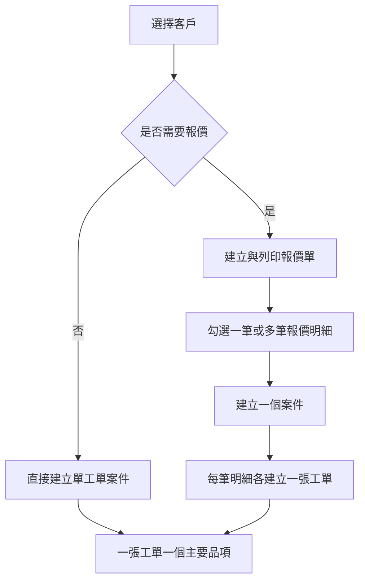

# 公司流程與新版改進

> 文件版本：v1.4
> 日期：2026-08-09
> 用途：定義新版系統必須保留的公司實際流程、已確認的新需求、要淘汰的舊功能及翻新後的改善方式。

## 1. 資料來源與判定順序

本文件統整以下證據：

1. 公司系統流程說明影片。
2. `Private & Shared` 的操作流程文字與 27 張畫面圖片。
3. Gmail 資料夾中的新版報價、工單、查詢、刪減及備份需求。
4. 舊 PowerBuilder 6 系統的 67 個視窗、155 個 DataWindow／報表、主選單及原始碼關聯。
5. 舊 SQL Server 資料表與已成功提取的客戶、工單、出貨、計價及帳款相關資料。

發生衝突時採用：

1. 公司明確的新需求。
2. 公司實際使用流程及操作圖片。
3. 舊程式原始碼與資料表，用來補足沒有說明的關聯與歷史欄位。
4. 設計推論；推論必須標示待確認，不得偽裝成公司已確認需求。

原始分析位置：

- `../extraction/ui-analysis/公司系統完整操作流程基準.md`
- `../extraction/ui-analysis/Gmail公司新需求整理.md`
- `../extraction/ui-analysis/舊系統介面與功能盤點.md`
- `../extraction/ui-analysis/系統功能關聯分析.md`
- `../analysis/新系統頁面元素與排列規格.md`
- `docs/Gmail附件需求逐項對照.md`（九份 PDF 與一張系統修改圖的逐欄需求、Slice 與驗收對照）

## 2. 現行公司實際流程


### 2.1 選擇客戶

- 使用客戶代號、名稱或簡稱搜尋。
- 選取後自動帶入客戶名稱、電話、聯絡人、地址等資料。
- 客戶資料不可在每張工單重複手打。
- 工單仍需保留當時客戶資料快照，避免客戶日後改名或搬家影響歷史文件。

### 2.2 建立工單／製程傳票

工單主要內容：

- 工單／傳票號碼、日期。
- 客戶單號、工作名稱／品名。
- 訂購數量、交貨日期、單價、版費、刀模費及備註。
- 面紙、底紙、浪紙。
- 紙質、供應商、尺寸與數量；公司新稿的面紙、底紙有廠別，浪紙未列廠別。
- 印刷尺寸、印刷數量、加減量、K 數及模數。
- 正反面 CMYK、特別色、上光、裱紙／裱浪。
- 各製程的協力廠與內容；上光、製版、軋型與糊邊再依附件顯示專屬欄位。
- 刀模圖、產品示意圖或其他附件。

新版必須把舊系統分散的頁籤與子視窗合併成同一張工單頁，但可用頁面內區塊、摺疊及黏著導覽維持易讀性。

### 2.3 新版／舊版與製程

- P0-08 已依公司新稿確認：工單保留「製版」製程，包含協力廠、製程說明、新版／舊版與天地／左右輪轉。
- 「新版／舊版」是一組單選，「天地／左右輪轉」是另一組單選；兩組不可併成四選一。
- 附件未要求預設值或必填，第一版不預選且允許留空，不自行推導「新版才必填曬版」等未簽認規則。
- 新建檔表單的製程順序為美工、輸出、製版、打樣、印刷、上光、裱紙、模具、軋型、加工、糊邊、運送、其他。
- 獨立色別設定與裁紙設定不做；附件未要求的獨立曬版、代版、留版欄位也不放入新建檔頁。舊資料內容仍只讀保留。

### 2.4 工單查詢

- 舊系統把現行傳票與歷史傳票分成兩個入口。
- 新版建議合併成單一工單查詢，以狀態、日期及封存條件區分。
- 搜尋至少涵蓋工單號、客戶單號、客戶名稱／簡稱、品名、備註、刀模號碼、特別色及製程說明。
- 結果必須顯示工單號、日期、客戶、品名、訂購量、交期、單價、版費與刀模費。

### 2.5 製程監管與完工

- 工單正式建立後進入製程監管。
- 使用者查看各製程的未開始、進行中、部分完成、已完成或不適用狀態。
- 每次完工量採追加紀錄，不直接覆寫累計總數。
- 完工修正採沖銷或調整紀錄，保存操作者、時間與原因。
- 必須區分「單一製程完成」與「最終完工入庫」；只有後者才能產生可出貨存貨。
- P0-03 已定案：第一版需先完成「運送」製程，再由具權限者執行獨立的「最終完工核定」才入庫；運送完成本身不自動增加庫存。

### 2.6 待出貨存貨

- 沒有最終完工入庫的品項，不得出現在可出貨清單。
- 可出貨量由庫存流水計算，不在工單保存可任意修改的庫存數字。
- 同一工單可部分完工、分批入庫、部分出貨及多次出貨。

建議數量定義：

```text
累計入庫量 = 所有有效的最終完工入庫流水
累計扣庫量 = 正式出貨量 + 備品量 + 其他負向調整
可出貨量   = 累計入庫量 - 累計扣庫量 + 有效沖銷量
```

### 2.7 出貨

- 先選客戶，再顯示該客戶的可出貨工單品項。
- 同一張出貨單可包含一筆或多筆來源工單。
- 每筆出貨明細保存來源工單、客戶單號、品名、完工量、本次正式出貨量、備品量、累計出貨量及當下可出貨量。
- P0-04 已定案：正式量與備品量都扣同一可出貨庫存，出貨單同時顯示兩欄與實際交付總量。
- 儲存時後端在同一資料庫交易內重新檢查可用量。
- P0-05 已定案：一般出貨不可造成負庫存。若已有有效的運送完成事件但庫存不足，具專用權限者可在出貨畫面輸入真實完工量與原因；同一交易先建立獨立完工入庫，再完成整張出貨，任何失敗全部回滾。兩個事件以 correlation ID 串接，不是負庫存 override。
- 可補登本次實際整批完工量；累計完工超過訂購量時必須警告並記錄原因。取消出貨不自動沖銷真實完工，舊資料 Import 也不合成這類事件。
- 出貨取消不可刪除原流水，必須建立反向流水。
- 儲存後可預覽與列印 A4 出貨單。

### 2.8 出貨計價與價格記憶

- 出貨完成後進入待計價清單。
- 舊系統以黃色表示未計價、白色表示已計價；新版仍可保留輔助色，但必須同時顯示文字狀態。
- 同一筆出貨明細不得重複產生基礎計價。
- 基礎計價預設以正式出貨量為基礎；備品只有在計價明細明確填入可請款數量及單價時才收費。
- 使用者可補充版費、刀模費或其他計價明細。
- 輸入計價內容時提供歷史內容、自動完成、最近價格、日期及來源。
- 使用者可選「只套用本次」或「套用並更新預設價格」。

### 2.9 請款、對帳與收款

- 只有已計價項目才能進入請款／對帳。
- 依客戶及帳款期間選取尚未請款的計價項目。
- 第一版只建立一種正式「對帳單」；「待請款／已請款」是流程狀態，不另外複製請款單資料。
- 對帳單保存品名、內容、數量、單價、版費、刀模費、小計、稅額、取整調整與總額快照。
- 新版報價與工單不顯示或計算稅額。對帳單可選計稅但預設關閉；啟用時才設定稅率與取整規則，發行時保存快照。
- 客戶舊資料的稅額、取整及歷史總額原樣保留並可核對，不硬編舊版 5%。
- 支援部分收款、一筆收款分配多張對帳單及一張對帳單多次收款。
- 已收、部分收款、未收款及作廢均須可追溯來源計價及出貨。

## 3. 新版整合的報價與案件分支

舊系統已有獨立報價表 `b_replay1`／`b_replay2`，但抽出的程式沒有找到報價自動轉製程傳票的可靠關聯；實際大量資料仍以直接建立 `subpoena` 工單為主。新版保留報價可選，並新增案件層串起同一客戶訂單的多張工單。



報價單需求：

- 自動單號，預設規則為年月日加二碼流水，但可由公司設定。
- 日期預設今天且允許修改；修改日期不應偷偷改變已配發的單號。
- 客戶資料自動帶入並保存文件快照。
- 明細包含序號、品名、尺寸、紙質、顏色、上光、版費、刀模費、數量、單價及附註。
- 單價至少顯示兩位小數。
- 版費與刀模費為獨立欄位。
- 支援另存新檔，新文件取得新單號並保存來源報價關係。
- A4 橫向列印，包含公司抬頭、客戶資料、報價資料、明細及備註。
- P0-01／P0-02 已定案：N 筆報價明細建立一個案件與 N 張單品工單；不同明細不合併成一張多品項工單。
- 直接建工單時系統在背景建立單工單案件，不要求員工多填一張表。

案件只負責分組、來源、客戶訂單及進度摘要；工單獨立保存品名、數量、材料、製程、完工、庫存及出貨。真正的 Todo／Task 是工單內的製程任務。

## 4. 舊系統問題與新版改善

| 舊系統問題 | 新版改善 |
|---|---|
| Windows XP 與 PowerBuilder 6，維護困難 | 瀏覽器操作，React＋FastAPI＋PostgreSQL |
| 工單分散多頁籤及子視窗 | 單頁分區工單與頁面內導覽 |
| 現行與歷史工單分開查詢 | 同一資料表與查詢頁，以狀態和封存日期區分 |
| 客戶與計價內容重複輸入 | 主檔自動帶入、客戶工作項目及價格歷史建議 |
| 完工與庫存總數可能被直接覆寫 | 完工與庫存採不可變流水帳及反向沖銷 |
| 未計價只靠顏色辨識 | 顏色加明確文字狀態 |
| 計價可能重複 | 來源出貨明細唯一限制與交易檢查 |
| 文件日後可能因主檔修改而變動 | 文件確認時保存 JSON／PDF 快照 |
| 刪除或轉歷史造成追查困難 | 作廢、封存、狀態與完整稽核，不搬移刪除主資料 |
| 查詢條件不足 | 全域關鍵字、日期、客戶、狀態及多欄位索引 |
| 備份不足或無還原驗證 | 自動雲端、公司硬碟、離線備份及定期還原演練 |
| 共用帳號難以追責 | 每人獨立帳號、角色與操作紀錄 |
| 正式資料和程式綁在舊電腦 | 可搬移容器、資料庫遷移、附件物件儲存與客戶持有雲端資產 |

## 5. 新版功能模組

### 5.1 第一版必做

1. 登入、使用者、角色與權限。
2. 公司資料、單號、列印與帳務設定。
3. 客戶資料與客戶歷史關聯。
4. 供應商／協力廠、紙質、紙廠／廠別及製程主檔。
5. 報價單、另存新檔、A4 橫向列印，以及選取明細建立案件與逐品項子工單。
6. 單頁工單、材料、印刷、製程、附件及 A4 列印。
7. 工單關鍵字查詢、狀態及封存。
8. 製程監管、逐次完工與最終完工核定。
9. 庫存流水、可出貨量與調整核准。
10. 部分出貨、多次出貨、備品、沖銷及 A4 出貨單。
11. 計價、防重複、額外明細與歷史價格記憶。
12. 請款／對帳、稅額、取整、部分收款及未收款。
13. 附件、列印快照、稽核、備份、還原與舊資料移轉。

### 5.2 第一版明確不做

- 微服務、Kubernetes、Redis、RabbitMQ、WebSocket。
- 手機優先的完整操作介面；第一版以公司 Windows 桌機為主。
- 色別設定維護頁。
- 裁紙設定維護頁。
- 已確認停用的舊物料管理與紙張應付對帳功能，除非公司重新提出需求。
- 直接刪除歷史色別、裁紙或其他舊資料；停用功能的歷史內容仍需保留可讀性。
- 未經確認的自動會計傳票、電子發票或銀行串接。

### 5.3 可延後功能

- 多租戶 SaaS 共用主機與自助開通。
- Cloud SQL、高可用資料庫與多區容錯。
- 手機完整編輯、離線操作及即時推播。
- 進階 BI、成本與毛利分析。
- 電子郵件自動寄送文件。
- OCR、自動辨識刀模圖或 AI 報價。

## 6. 核心不可破壞規則

1. 未經最終完工入庫，不得出貨。
2. 可出貨量不得以畫面暫存值為準，儲存時必須由後端重新計算並鎖定。
3. 同一出貨明細不得重複基礎計價。
4. 同一計價明細不得重複請款。
5. 收款分配總額不得超過有效收款金額或請款未收餘額。
6. 完工、庫存、出貨、計價、請款及收款修正只能作廢、沖銷或調整。
7. 所有業務單據保存來源關係、當時資料快照與操作者。
8. 報價或工單另存新檔必須產生新單號，不得複用原單號。
9. 金額不得使用浮點數作最終計算。
10. 任何跨公司資料讀寫都必須被拒絕。
11. 後端拒絕無權限、非法狀態轉換與缺少修改原因的高風險操作。
12. 舊資料匯入必須保留來源系統與原始主鍵，且能對帳。
13. 舊系統全量資料不限年份；每筆來源都必須對應正式匯入、只讀封存、合併 mapping 或例外待處理狀態，不可靜默丟棄。

## 7. 介面總覽

| 主選單 | 頁面 |
|---|---|
| 工作台 | 待交、進行中、待出貨、待計價、未收款與異常提醒 |
| 客戶 | 客戶清單、建立／編輯、客戶相關報價／工單／出貨／帳款 |
| 報價 | 報價清單、編輯、另存新檔、A4 橫向預覽、轉工單 |
| 案件 | 案件清單、詳情、來源報價、子工單與進度摘要 |
| 工單 | 工單查詢、單頁編輯、詳情、附件、列印、作廢／封存 |
| 製程 | 製程監管、完工登記、最終完工核定、時間軸 |
| 存貨 | 待出貨存貨、數量來源、調整與沖銷 |
| 出貨 | 出貨清單、建立、詳情、取消／沖銷、A4 列印 |
| 計價請款 | 待計價、計價明細、價格歷史、對帳單、收款、未收款 |
| 基礎資料 | 供應商／協力廠、紙質、紙廠／廠別、製程 |
| 系統設定 | 公司、單號、帳務、列印、使用者、角色、稽核、備份狀態 |

## 8. Phase 1 前後續確認

1. P1-01：價格建議依客戶、品名、規格或公司共用，預設取哪一筆。
2. P1-02：管理員、業務、生產、會計與唯讀角色的實際權限；P0-05 的專用 capability 已定義，但角色 mapping 尚未定。

P0-01～P0-10 已於 2026-08-09 全部確認。公司亦確認 UI 以 PDF 的欄位、分區、順序、單頁操作及列印內容為契約，外觀採現代工業 ERP 與 RWD，不複製舊 Windows XP 像素外觀。
