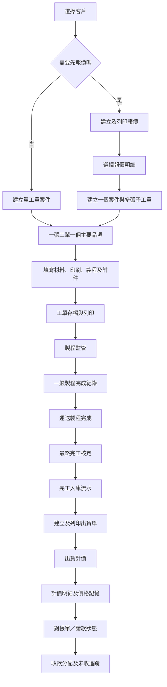
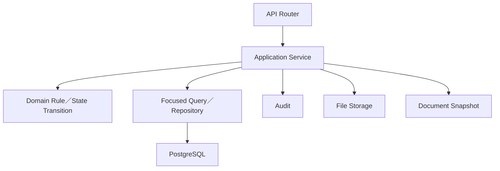
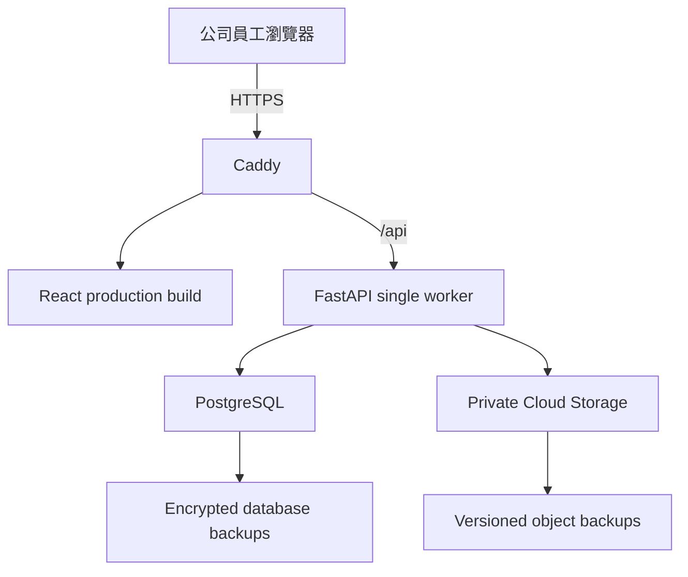
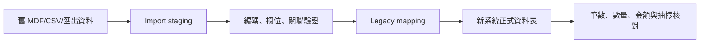

# 公司管理系統最終架構

> 文件版本：v1.28
> 日期：2026-08-20
> 狀態：開發基準
> 取代文件：`/Users/kk98033/Downloads/公司管理系統_架構與本機初始化設計.md` v0.1

## 1. 架構目標

本系統用來取代公司在 Windows XP 上運行的 PowerBuilder 6 桌面系統，改為由公司 Windows 電腦透過瀏覽器操作的內部管理網站。

架構必須同時滿足：

- 完整支援公司目前的工單到收款流程。
- 加入新版報價、工單單頁化、查詢、價格記憶與備份需求。
- 兩位使用者可同時操作，不發生超量出貨或重複計價。
- 開發者可先在 Mac／Windows 本機建置、測試及展示。
- 正式環境低成本、可備份、可還原、可搬移。
- 未來可提供其他公司使用，但不讓第一版承擔過度複雜的 SaaS 架構。
- 舊資料可分批匯入、核對及保留來源。

## 2. 最終技術決策

| 層級 | 決策 | 說明 |
|---|---|---|
| 架構型態 | 模組化單體 | 一個前端、一個後端、一個主要資料庫，依業務模組分層 |
| 前端 | React＋TypeScript＋Vite | 桌面版密集表單、清單、查詢及列印預覽 |
| UI | ADR-010 平面工業 Design Tokens＋共用 React 版型；Ant Design 僅保留為未來可選底層元件 | 正式視覺採 A 架構＋C 表單清晰度；不混用完整 UI 框架，第三方元件也必須符合專案 Tokens |
| 路由 | TanStack Router | 型別安全的頁面與業務路由；選用與版本限制見 ADR-009 |
| API 狀態 | TanStack Query | 查詢、快取、失效與 mutation |
| 表單 | React Hook Form＋Zod | 表單狀態與前端格式驗證 |
| 日期 | date-fns | 顯示與表單日期；資料交換採 ISO 8601 |
| 後端 | FastAPI＋Python | REST API、權限、交易、檔案及列印資料 |
| ORM／遷移 | SQLAlchemy 2 同步模式＋Alembic | 第一版以簡單、可除錯及可靠交易為優先 |
| 資料庫 | PostgreSQL | 關聯、NUMERIC、交易、鎖、流水帳與搜尋 |
| 開發環境 | Docker Compose＋本機前後端工具 | PostgreSQL 容器化，前端／後端可本機熱更新 |
| 反向代理 | Caddy | 正式 HTTPS、靜態檔及 `/api` 路由 |
| 正式主機 | Google Compute Engine | 第一家公司使用客戶公司持有的獨立專案 |
| 正式附件 | 私人 Cloud Storage | VM 本機磁碟不是附件唯一來源 |
| 備份 | Cloud Storage＋公司硬碟＋離線外接硬碟 | 資料庫、附件、快照、設定及還原文件一起保存 |
| 自動測試 | Pytest、Vitest、RTL、Playwright | 單元、整合、API、E2E 與列印驗收 |

第一版不使用：

- 微服務。
- Kubernetes。
- Redis。
- RabbitMQ 或 Kafka。
- WebSocket。
- Elasticsearch。
- 伺服器常駐 Chromium。

若未來出現已量測的效能或非同步需求，再以實際證據新增基礎設施。

## 3. 最終業務流程



修正版的關鍵差異：

- 報價不是必經流程。
- 採「案件 → 工單 → 製程任務」三層模型；案件集中管理同一客戶訂單，工單保持獨立生產追蹤。
- `quotation_item` 是轉換來源單位；N 筆明細在同一案件下建立 N 張工單，不合併成一張多品項工單。
- 直接建工單時由系統自動建立單工單案件，不增加操作步驟。
- 一般製程完成不會自動增加庫存。
- 第一版需運送製程完成後，由具權限者獨立核定；只有這個 command 會建立正向庫存流水。
- 正式出貨量及備品量分欄保存，兩者都扣庫存；基礎計價預設只使用正式量。
- 第一版使用一種對帳單，請款是狀態；計稅預設關閉，啟用時才保存稅率與取整快照。

## 4. 專案與執行環境

```text
company-system/
├─ frontend/
│  ├─ src/
│  │  ├─ app/                 # Router、Providers、Layout
│  │  ├─ features/            # 業務模組
│  │  ├─ components/          # 共用元件
│  │  ├─ ui/                  # ADR-010 通用頁首、KPI、篩選、表格、表單與狀態元件
│  │  ├─ api/                 # OpenAPI snapshot／generated Fetch client／安全錯誤邊界
│  │  ├─ services/            # TanStack Query 與跨頁面查詢封裝
│  │  ├─ schemas/             # Zod schemas
│  │  ├─ styles/              # Tokens、全域及列印 CSS
│  │  └─ test/                # 測試共用工具
│  ├─ public/
│  └─ package.json
├─ backend/
│  ├─ app/
│  │  ├─ api/v1/              # FastAPI routers
│  │  ├─ core/                # 設定、安全、例外、logging 與跨模組 database infrastructure
│  │  │  └─ database/         # Engine、Session、Base、readiness、lifecycle
│  │  ├─ modules/             # 各業務模組
│  │  ├─ printing/            # 文件快照與模板資料
│  │  ├─ storage/             # 本機／Cloud Storage adapter
│  │  └─ main.py
│  ├─ migrations/             # Alembic migrations；設定檔為 backend/alembic.ini
│  ├─ tests/
│  └─ pyproject.toml
├─ infra/
│  ├─ compose/
│  ├─ caddy/
│  ├─ backup/
│  └─ deploy/
├─ e2e/
├─ scripts/
├─ storage/                   # 本機開發附件，不提交 Git
├─ docs/
├─ compose.yaml
├─ .env.example
├─ Makefile
└─ README.md
```

### 4.1 本機模式

第一版採混合開發模式：

- PostgreSQL：Docker Compose。
- React：本機 Node.js 執行，取得快速 HMR。
- FastAPI：本機 Python virtual environment 執行，方便除錯。
- 另提供全容器模式，供交接及 CI 驗證。

預定網址：

| 服務 | 開發網址 |
|---|---|
| React | `http://localhost:5173` |
| FastAPI | `http://localhost:8000` |
| 開發 API 文件 | `http://localhost:8000/docs` |
| PostgreSQL | `localhost:5432`，只綁本機 |

前端只呼叫 `/api/v1`。Vite 開發代理到後端；正式環境由 Caddy 代理，因此程式碼不保存環境專屬 API 網址。

### 4.2 環境分離

- `.env.example` 只保存欄位名稱與安全假值。
- `.env.local`、`.env.test`、正式 Secret 不提交 Git。
- 開發、測試及正式資料庫使用不同資料庫與帳號。
- `APP_ENV` 只允許 `development`、`test`、`production`；啟動時解析 DSN 的實際 database name 與 username，兩者都必須只有對應的 `dev`／`test`／`prod` 標記。
- 必要設定、帳號、密碼、資料庫名稱、跨環境或混合標記不合法時 fail-fast；`DATABASE_URL` 以 Secret 型別保存，驗證錯誤不得回顯輸入值。
- 測試資料庫可重建；正式資料庫不得由測試命令連入。
- 正式遷移由部署步驟單獨執行，不在多個 web worker 啟動時自動競爭執行。

## 5. 前端架構

### 5.1 責任

- 顯示頁面、表格、表單、狀態、錯誤及操作結果。
- 前端進行必填、格式、顯示及操作防呆。
- 保留列表的搜尋、排序、分頁及欄位偏好。
- 提供 A4 預覽與瀏覽器列印。
- 不自行決定最終庫存、是否重複計價、稅額或權限。

### 5.2 業務模組

```text
features/
├─ auth
├─ dashboard
├─ organizations
├─ customers
├─ vendors
├─ master-data
├─ quotations
├─ cases
├─ work-orders
├─ production
├─ inventory
├─ shipments
├─ pricing
├─ billing
├─ attachments
├─ audit
└─ settings
```

每個 feature 可包含：

```text
api/
components/
pages/
schemas/
types/
utils/
tests/
```

不得建立一個包含所有 domain 的巨大 `utils`、`types` 或全域 store。

### 5.3 狀態策略

- 後端資料由 TanStack Query 管理。
- React Hook Form 管理表單暫存。
- 全域狀態只保存登入者、目前公司、介面偏好及必要 UI 狀態。
- API 成功後以回傳資料或重新查詢為準，不在前端自行假設交易結果。
- 金額與精確數量透過 API 使用字串傳輸。
- 日期使用 `YYYY-MM-DD`，時間使用含時區 ISO 字串。

### 5.4 共用元件

- `PageHeader`：標題、狀態、主要操作。
- `SearchToolbar`：關鍵字、日期、客戶、狀態及清除條件。
- `DataTable`：分頁、排序、欄位設定、空狀態。
- `StatusTag`：顏色加文字，不只靠顏色。
- `MoneyInput`、`QuantityInput`：精度、格式及負數規則。
- `CustomerPicker`、`VendorPicker`、`WorkOrderPicker`。
- `AuditTimeline`：顯示關鍵異動與原因。
- `AttachmentPanel`：上傳、預覽、下載、軟刪除。
- `PrintPreview`：A4 尺寸、縮放提醒及列印。
- `DangerActionDialog`：作廢、沖銷與原因；已簽認的「出貨中補登完工」使用獨立業務對話框，顯示補登前餘額、實際完工量及交易後餘額，不命名為超量出貨。

### 5.5 型別來源

- FastAPI OpenAPI 是 API request／response 型別基準。
- 由 deterministic OpenAPI snapshot 使用精確鎖版 Orval 產生 Fetch TypeScript client；generated 檔案提交 Git但禁止手改。
- 前端不得另外手寫一套同名但語意不同的 DTO。
- generated client 的 non-2xx 必須由手寫 API boundary 轉成 TanStack Query error；UI 只顯示後端安全 message 或固定 fallback，不顯示 raw exception。
- 產生的型別不直接取代 UI form schema；UI schema 可做顯示層轉換。

## 6. 後端架構



### 6.1 模組

- `auth`：登入、登出、session、CSRF、密碼及登入稽核。
- `organizations`：公司、成員、角色、公司及帳務設定。
- `customers`：客戶、聯絡、帳務偏好及關聯摘要。
- `vendors`：供應商、協力廠及結帳設定。
- `master_data`：紙質、紙廠／廠別、製程定義及顯示順序。
- `quotations`：報價、明細、另存新檔、轉工單及快照。
- `cases`：客戶訂單／報價分組、子工單清單、案件進度摘要及來源追蹤。
- `work_orders`：工單、材料、印刷、製程、附件、搜尋及封存。
- `production`：製程進度、完成紀錄及最終完工核定。
- `inventory`：庫存流水、可出貨量、調整及沖銷。
- `shipments`：出貨、備品、鎖定、取消及列印。
- `pricing`：計價、額外明細、防重複及價格建議。
- `billing`：請款、對帳、稅額、取整、收款及分配。
- `printing`：文件輸入資料、快照、模板版本。
- `attachments`：檔案驗證、Cloud Storage 及權限下載。
- `audit`：操作、前後值、原因與 request id。
- `imports`：舊資料 staging、mapping、驗證、核對及匯入批次。
- `operations`：只讀工作台、跨模組搜尋、客戶 360 與固定欄位 CSV 匯出；摘要不得成為業務資料來源。

### 6.2 Service 原則

- Router 只處理 HTTP、schema 與 service 呼叫。
- Service 決定交易邊界、權限、狀態轉換及跨表規則。
- Repository／Query 只在查詢複雜或需要隔離資料存取時建立，不做無意義的通用 CRUD repository。
- 所有修改 service 明確接收操作者及 organization context。
- 高風險命令接收 `reason`、`expected_version` 及可選的 idempotency key。

### 6.3 API 規劃

統一使用 `/api/v1`：

| 路徑 | 用途 |
|---|---|
| `/auth/*` | 登入、登出、目前使用者、CSRF |
| `/organizations/*` | 公司、成員及設定 |
| `/customers/*` | 客戶查詢、維護及關聯摘要 |
| `/vendors/*` | 供應商／協力廠 |
| `/master-data/*` | 紙質、廠別及製程 |
| `/quotations/*` | 報價、複製、確認、列印及轉工單 |
| `/cases/*` | 案件查詢、詳情、子工單與進度摘要 |
| `/work-orders/*` | 工單 CRUD、查詢、封存及列印 |
| `/work-orders/{id}/materials` | 工單材料 |
| `/work-orders/{id}/print-specs` | 印刷規格 |
| `/work-orders/{id}/processes` | 製程 |
| `/production`、`/production/work-orders/{id}` | 已確認工單的製程監管與 13 道狀態 |
| `/production/work-orders/{id}/process-events` | 製程開始、部分完成、完成及重開事件 |
| `/production/work-orders/{id}/final-completions` | 運送完成後的獨立最終完工入庫 |
| `/production/final-completions/{id}/reverse` | 完工沖銷與反向庫存流水 |
| `/inventory`、`/inventory/{id}/ledger` | 可出貨清單與不可變流水追蹤 |
| `/inventory/{id}/adjustments` | 具原因與權限的人工庫存調整 |
| `/shipments/*` | 出貨、取消、列印 |
| `/pricing-documents/*` | 計價及額外明細 |
| `/price-suggestions` | 內容與歷史價格建議 |
| `/statements/*` | 請款／對帳 |
| `/receipts/*` | 收款與分配 |
| `/attachments/*` | 附件上傳、授權下載及刪除標記 |
| `/audit-logs` | 稽核查詢 |
| `/imports/*` | 舊資料試匯、錯誤及核對結果 |
| `/operations/dashboard`、`/operations/search` | 依既有 read capability 顯示工作台與跨模組搜尋 |
| `/operations/customers/{id}` | 依各模組 read capability 組合客戶 360 往來 |
| `/operations/exports/{dataset}.csv` | 固定欄位、最多一萬筆、UTF-8 BOM 與公式注入防護的 CSV |
| `/health/live`、`/health/ready` | 存活與相依服務健康檢查 |

列表 API 統一規範：

- 使用 1-based `page`；預設每頁 25 筆、最多 100 筆，`page` 最多 1,000,000，禁止一次回傳全部歷史資料。
- 排序方向只允許 `asc`／`desc`；每個 endpoint 必須以自己的 `StrEnum` 定義欄位白名單，不允許裸字串或任意 SQL 欄位排序。
- 共用 `keyword` 最多 100 字元、去除前後空白；全空白視為未套用。日期區間含頭含尾且起日不得晚於迄日；只有唯一主要日期的 endpoint 可使用通用 `date_from`／`date_to` 並明載日期語意，多日期列表由 domain 定義 `delivery_date_from` 等明確名稱。
- `status` 必須使用各 domain 的 enum；`customer_id` 必須等一致 ID 與 organization scope 後由 domain 定義，不建立萬用字串 filter。
- 回傳 `items`、總筆數、總頁數、前／後頁狀態、實際排序與已正規化的目前篩選摘要。
- 大量匯出使用專用 endpoint 與權限，不從一般列表無限制抓取。
- 跨模組查詢只組合呼叫者原本可讀的 domain，不建立可繞過模組權限的 `operations.read` 萬用權限；所有查詢仍以 Session organization 為唯一 scope。

所有 runtime 錯誤，以及 OpenAPI 實際宣告的 4xx、422、500、503，使用同一 `ErrorResponse` envelope；`live` 不宣告不可能發生的 dependency 503。驗證錯誤只能回傳欄位位置、穩定錯誤類型與固定安全文案，不回顯原始 input、validator context、URL 或任意例外文字。HTTP 錯誤只白名單保留 `Allow`、`WWW-Authenticate`、`Retry-After` 等協定必要 header；production 關閉 `/docs` 與 `/openapi.json`，development／test 保留供開發驗證。

### 6.4 Database lifecycle 與 migration

- 採 SQLAlchemy 2 同步模式、Alembic 與 psycopg 3；不自行實作 connection pool、ORM 或 migration runner。
- `app/core/database/` 是跨業務模組的 infrastructure boundary，分為 resources、session、Base metadata、readiness 與 FastAPI lifecycle；router 與 service 不得自行建立 engine。
- 每個 app 擁有一個 lazy engine 與 session factory；小型 VM pool 固定 5 connections、2 overflow、5 秒 timeout，開啟 `pool_pre_ping` 且關閉 parameter log。
- 每個 request 使用獨立 Session；dependency 在錯誤時 rollback 並永遠 close，但不自動 commit。交易與 commit 由後續 application service 明確控制。
- `/health/ready` 每次以 `SELECT 1` 驗證真實連線；`live` 不碰資料庫。app shutdown 必須 dispose 自己擁有的 engine。
- Alembic 位於 `backend/migrations/`，只由獨立命令執行，不在 API startup 自動 migration。Slice 0.5 的 `0001_empty_baseline` 不建立任何業務表。
- integration 使用獨立 `postgres-test`：username／database 皆帶 `_test`、只綁 `127.0.0.1:5433`、資料放 tmpfs；不得使用或刪除 development named volume。

## 7. 資料模型

### 7.1 公司與權限

| 資料表 | 主要內容 |
|---|---|
| `organizations` | 公司 boundary、名稱、統編、負責人、電話、傳真、Email、地址、狀態與 Logo object metadata；Logo binary 仍放私人物件儲存 |
| `users` | 全域使用者代號、顯示名稱、密碼雜湊、狀態、最後登入；新系統不匯入舊密碼 |
| `organization_members` | 使用者、公司及啟停用；複合唯一鍵供角色指派強制公司隔離 |
| `permissions` | 全域、正規化的動作 capability 目錄；不保存角色名稱捷徑或萬用字元 |
| `roles`、`role_permissions` | 公司內角色及其 capability 集合；P1-02 前不寫死業務角色 mapping |
| `organization_member_roles` | 成員角色指派；兩組複合外鍵在 DB 層拒絕跨公司角色 |
| `sessions` | 只存 token digest、綁定公司成員、到期及撤銷；不得保存 raw token |
| `login_throttle_states` | 公司＋登入 bucket 的 HMAC 指紋、短期失敗數與限制到期；不保存 raw 帳號、密碼或 IP |
| `login_security_events` | append-only 登入失敗、限制及成功事件；以 Request ID 關聯且不含原始 credential |
| `organization_settings` | 一家公司一筆；對帳單可選計稅草稿（預設關閉），以及不可由 UI 改寫的單號／報價列印／工單列印政策版本 |
| `customers` | 公司範圍客戶主檔；代號、名稱、簡稱、統編、主要聯絡、地址、狀態與更新時間；同公司正規化代號唯一，停用不刪除 |

`organization_settings` 只保存目前已簽認且確實屬於公司層級的設定。計稅關閉時，稅率、取整範圍及小數位必須全部為空；啟用時三者必須完整，稅率大於 0 且不超過 100，小數位為 0～4。Phase 8 計算器已正式消費這份設定並在每張對帳單保存快照；狀態 `active_company_uat_pending` 表示工程功能已啟用，但公司實際案例與印表機 UAT 尚未簽認。ADR-018 單號格式與公司 PDF 已確認的報價／工單列印政策以固定版本保存；本表不建立通用功能旗標，也不負責配置實際流水或保存文件。

### 7.2 基礎資料

| 資料表 | 主要內容 |
|---|---|
| `customers` | 已實作代號、名稱、簡稱、統編、主要聯絡、地址、付款條件、狀態，以及 legacy 稅額／取整與來源鍵的唯讀對照 |
| `customer_contacts` | 多位聯絡人及聯絡方式；目前尚未建立，等公司確認多聯絡人操作後另切片實作 |
| `vendors` | 供應商／協力廠、類別、聯絡、結帳日與停用狀態；同公司代號唯一 |
| `paper_types` | 紙質名稱、規格、啟用狀態 |
| `paper_mills` | 紙廠／廠別 |
| `process_definitions` | 製程代碼、名稱、排序與啟用狀態；第一版不讓任意製程自由設為入庫觸發 |
| `customer_work_items` | 客戶常用品名／規格／參考單價與 manual／legacy／work_order 來源；複合外鍵保證與客戶同公司 |

不建立色別設定及裁紙設定維護表；歷史文字值在匯入資料中保留。

### 7.3 報價與工單

| 資料表 | 主要內容 |
|---|---|
| `quotations` | 公司範圍客戶、`QUO-YYYYMMDD-SS`、日期、抬頭／客戶 JSON 快照、草稿／確認／作廢、另存來源、文件／列印 metadata 及 legacy 舊號／含稅唯讀值；新版 active 報價不建立稅額 UI |
| `quotation_items` | 報價內動態序號、品名、尺寸、紙質、顏色、上光、版費、刀模費、數量、單價與明細附註；同報價序號唯一 |
| `production_cases` | 客戶、來源報價、`CASE-YYYYMMDD-SSS`、日期、狀態、公司／客戶快照及 legacy 舊號；只負責分組與摘要 |
| `work_orders` | 所屬案件、來源報價明細、`WO-YYYYMMDD-SSS`、單一主要品名、數量、交期、價格、typed 三紙／印刷／13 道製程 JSON、確認文件快照、列印 metadata 及 legacy 舊號 |
| `work_order_attachments` | 私人附件 metadata、SHA-256、5MB 內內容及軟刪除時間；工單確認後停止增刪 |
| `process_events` | 製程開始、部分完成、完成與重開事件；同製程依序追加，不與 Phase 4 建檔規劃混為同一動作 |

Phase 4 先以 Pydantic `extra=forbid`、固定順序與專屬欄驗證保護三紙、印刷、製程 JSON；需要跨工單逐欄分析或流程事件時，再由可逆 migration 正規化讀模型／事件表，不在同一工單重複保存兩份可漂移真相。

P0-01／P0-02 已定案：一個案件可有多張工單，一張工單只對應一個主要成品。報價選取多筆時建立一個案件與多張子工單；直接建工單時自動建立單工單案件。詳見 ADR-014。

P0-08 已定案：新建檔表單不增加獨立曬版、代版、留版欄位；舊系統內的相關值保留在 legacy 只讀資料中。詳見 ADR-012。

### 7.4 完工、庫存與出貨

| 資料表 | 主要內容 |
|---|---|
| `final_completion_entries` | 工單、本次核定入庫量、日期、運送製程事件、操作／核准者、來源類型、correlation ID、沖銷來源 |
| `inventory_adjustments` | 工單、正負調整量、原因、核准者及冪等鍵 |
| `inventory_ledger` | 工單、事件類型、正負數量、完工／調整來源及原因；所有餘額只由流水加總 |
| `shipments` | 出貨單號、客戶、日期、地址快照、狀態 |
| `shipment_items` | 出貨單、來源工單、正式出貨量、備品量、當下快照 |

`shipment_items` 分開保存：

- `delivered_quantity`：正式出貨數量。
- `spare_quantity`：備品數量。
- `inventory_consumed_quantity`：依公司規則計算並保存的實際扣庫量。

已定案：

```text
inventory_consumed_quantity = delivered_quantity + spare_quantity
```

基礎計價的數量預設只取 `delivered_quantity`；備品收費必須在 `pricing_items` 明確保存可請款數量與單價。

Phase 6 實作補充：出貨草稿保存可編輯明細，確認後資料庫拒絕修改或刪除明細。正式量與備品分別建立 `shipment_delivered`／`shipment_spare` 負向流水；取消則建立相對應正向 reversal 流水。出貨狀態保留原文件，補登完工是獨立 `shipment_completion` 完工事件，所以取消出貨不會反轉已發生的真實完工。

Phase 7 實作補充：`0021_pricing` 已建立計價文件、明細及價格歷史。每筆出貨明細最多只有一筆基礎計價；基礎數量只取正式出貨量，備品需另建 `spare` 明細並明確保存可請款數量及單價。手動明細可保存版費、刀模費或其他內容，但不能偽裝成出貨來源。確認計價保存文件快照與價格歷史；只有明確勾選且具 `price_default.update` capability 才更新該公司／客戶／品名／規格的預設價格。

Phase 8 實作補充：`0022_billing` 已建立 `statements`、`statement_items`、`receipts` 與 `receipt_allocations`；`0023_billing_invariants` 另以 PostgreSQL trigger 鎖定收款／對帳來源並拒絕超額分配、跨客戶關聯及帳務明細直接修改或刪除。有效對帳來源由部分唯一索引防止重複；對帳發行保存客戶、來源、稅率、取整及金額快照。對帳狀態由有效分配推導，收款沖銷只停用分配並恢復餘額，不刪除原交易。帳齡由對帳日與指定基準日即時計算，不另存易漂移的摘要。

### 7.5 計價、請款與收款

| 資料表 | 主要內容 |
|---|---|
| `pricing_documents` | 客戶、來源出貨、狀態、計價日期及快照 |
| `pricing_items` | 來源出貨明細或手動明細、內容、數量、單價、小計 |
| `price_history` | 客戶、品項、規格、內容、價格、日期、來源、是否預設 |
| `statements` | 單一對帳單：客戶、期間、請款狀態、預設關閉的計稅開關、稅率、取整、小計、稅額、調整及總額 |
| `statement_items` | 來源計價明細、文件快照、金額 |
| `receipts` | 收款日期、方式、金額、參考號、狀態 |
| `receipt_allocations` | 收款對對帳單的分配金額 |

限制：

- `pricing_items.source_shipment_item_id` 對「基礎計價」建立部分唯一限制；手動額外明細可為空。
- `statement_items.source_pricing_item_id` 不可重複出現在有效對帳單明細。
- 收款分配合計不得超過收款金額。
- 有效收款分配不得讓對帳單未收餘額小於零。
- 新對帳單計稅預設關閉；啟用時的稅務與取整結果在文件發行時保存，不因客戶設定後續變更而重算歷史文件。

### 7.6 檔案、快照、稽核與匯入

| 資料表 | 主要內容 |
|---|---|
| `attachments` | 私人檔案中繼資料、雜湊、object key、軟刪除 |
| `document_snapshots` | 文件類型、模板版本、JSON 資料、PDF object key、確認時間 |
| `document_sequences` | 公司、文件類型、日期區段、目前序號、格式版本 |
| `audit_logs` | 公司、使用者、動作、對象、前後值、原因、request id |
| `import_runs` | 來源系統、manifest 雜湊、程式版本、開始／完成、資料列數及既定 Import 狀態 |
| `import_source_files` | run 內相對路徑、來源表、檔案雜湊、大小、實體行、含表頭邏輯列及資料列數 |
| `import_staging_records` | Phase 0 通用 raw／normalized JSONB envelope、來源檔／表／列／key 及驗證狀態 |
| `legacy_mappings` | 舊系統／表／key／mapping slot 對新版 UUID；跨 run 唯一，阻止同一來源重複套用 |
| `import_errors` | run／file／row／field scope、欄位、原值、錯誤及 resolved／ignored 處理狀態 |

I-0.3 先採通用 `import_staging_records`，因客戶、工單及帳務正式 schema 尚未簽認；各 domain 在 I-1.x 之後加入 typed mapping，不能把 JSONB 直接當正式業務模型。run、source file、staging、error 與 mapping 的重複 trace 欄位使用複合外鍵維持一致；來源雜湊可跨 run 重跑，但 `legacy_mappings` 的來源 identity 唯一鍵不包含 run ID。

`audit_logs` 採 append-only：application service 只在呼叫者持有的業務 transaction 內 stage event，不自行 commit；業務異動失敗時稽核一起 rollback。PostgreSQL trigger 拒絕一般 UPDATE／DELETE，正式 application role 亦不得取得 TRUNCATE／DDL 權限。actor membership 以 organization 複合外鍵防止跨公司偽造；before／after 只保存必要欄位，寫入與讀出都再遮罩 password、hash、Cookie、CSRF、Session、Token、Secret、私鑰及檔案內容。每個 HTTP request 由伺服器產生 UUID Request ID，忽略 client 同名 header；成功與錯誤 response 都回傳該 ID，log 與 audit 可關聯。

登入失敗限制依 ADR-024 使用公司 ID 與登入 bucket 的 HMAC 指紋；15 分鐘內第五次失敗開始限制 15 分鐘。成功登入與失敗狀態清除、Session 建立、安全事件共用交易；同一 bucket 由 PostgreSQL advisory lock 防止並行遺失計數。已知與未知帳號使用相同門檻及公開錯誤，不把 raw 帳號、密碼或 IP 寫入 throttle／security event。A、B 公司因 organization ID 與正式部署 Secret 不同而互不共用計數。

### 7.7 共通欄位

主要業務表至少包含：

- `id`：UUID 或一致的不可猜測主鍵策略。
- `organization_id`。
- `created_at`、`created_by`。
- `updated_at`、`updated_by`。
- `version`：樂觀鎖。
- `status`。
- `cancelled_at`、`cancelled_by`、`cancel_reason`，適用時。
- `legacy_source`、`legacy_id`，由移轉資料需要決定。

金額使用 `NUMERIC`；數量精度依單位定義，第一版不得以 `float` 保存。

## 8. 交易與資料完整性

### 8.1 單號

- 格式為 `QUO-YYYYMMDD-SS`、`CASE-YYYYMMDD-SSS`、`WO-YYYYMMDD-SSS`、`SHP-YYYYMM-SSS`、`PRC-YYYYMMDD-SSS`、`STM-YYYYMM-SSS`、`RCT-YYYYMMDD-SSS`。
- 單號由後端在資料庫交易中配置。
- 唯一條件包含 `organization_id + document_type + document_number`。
- 使用 sequence row lock 或 PostgreSQL 原生安全機制處理同時建立。
- 單據日期改動後不自動偷換已配發單號。
- 作廢單號不重複使用。
- 舊單號原樣保存在 `legacy_document_number` 並可搜尋，不補英文前綴；詳見 ADR-018。

### 8.2 最終完工入庫

同一交易：

1. 檢查工單及狀態。
2. 檢查「運送」製程已完成、本次實際完工數量及權限。
3. 寫入 `final_completion_entries`。
4. 寫入正向 `inventory_ledger`。
5. 更新必要摘要版本。
6. 寫入 audit log。

### 8.3 建立出貨

同一交易：

1. 鎖定相關工單或可用庫存聚合來源。
2. 重新加總有效庫存流水。
3. 檢查正式出貨量及備品量。
4. 可出貨量不足時拒絕一般出貨，不建立負庫存核准後門。
5. 若已有有效運送完成事件且使用者具 `shipment.complete_and_confirm`，可輸入真實完工量與原因；同一交易先建立獨立最終完工紀錄及正向流水。
6. 寫入整張出貨主檔、明細及負向庫存流水；多明細任一步失敗全部回滾。
7. 以 correlation ID、idempotency key 串接兩事件，重新確認交易後庫存非負並寫 audit log。累計完工超過訂購量時必須警告並保存原因。

前端曾讀到的可出貨數量只供顯示，不能保證儲存成功。

### 8.4 計價與請款

- 計價建立時鎖定或以唯一限制保護來源出貨明細。
- 捕捉唯一限制衝突並回傳可理解錯誤，不顯示資料庫堆疊。
- 請款以有效來源計價明細建立，不使用純文字複製後失去關聯。
- 任何取消建立反向或狀態紀錄，禁止刪除來源。

### 8.5 Idempotency

對使用者可能重按或網路重送的高風險 POST，可使用 idempotency key：

- 最終完工。
- 建立出貨。
- 完成計價。
- 建立請款。
- 登記收款。

## 9. 狀態模型

不在 `work_orders` 使用一個涵蓋整個流程的巨大狀態。各 aggregate 自己維護狀態，畫面摘要由後端計算。

### 工單

```text
draft → confirmed → in_production → partially_completed → completed → archived
                         ↘ cancelled
```

### 製程

```text
not_applicable | pending → in_progress → partially_completed → completed → reopened
```

### 出貨

```text
draft → confirmed → cancelled/reversed
```

### 計價／請款／收款

```text
pricing: draft → confirmed → cancelled
statement: draft → issued → partially_paid → paid → cancelled
receipt: confirmed → reversed
```

每個 transition 都在後端以明確 command／service 執行，不允許一般 PATCH 任意指定狀態。

## 10. 多公司隔離策略

第一家公司獨立部署，但資料模型從第一天保留 `organization_id`。

### 第一版

- 所有業務唯一限制包含 `organization_id`。
- API 從登入 session 取得目前公司，不接受前端任意指定別家公司。
- Router 以 `require_organization_scope` 從 active Session 建立唯一可信 scope；body、query 與 header 的公司 ID 都不能覆蓋。
- SELECT／UPDATE／DELETE 使用 `OrganizationScope.constrain(statement, model=...)` 自動加入 model 的 `organization_id` 條件；單筆越界與不存在都不可洩漏另一家公司是否有該 ID。
- CREATE 使用 `OrganizationScope.create_values()` 注入公司 ID；application code 自行傳入 `organization_id` 會在 SQL 前拒絕。
- 跨公司關聯先用 `require_same_organization()` 驗證，核心外鍵再使用 organization 複合鍵雙重保護。
- 附件 object key 以 `organizations/{organization_id}/...` 開頭。
- 自動測試建立 A、B 兩家公司，驗證跨公司讀寫全部被拒絕。

### 第二家公司獨立訂製

- 沿用同一套程式碼、migration、測試與 release tag，不建立長期分岔的「A 版／B 版」程式。
- B 公司使用獨立部署、資料庫、附件 bucket／prefix、Secret、備份與公開 organization 設定；A、B 的正式資料與帳密不共用。
- 公司差異以 organization settings、角色 capability、功能開關、文件模板版本及 Import mapping 表達；新增差異前仍須進需求矩陣與 ADR，不在頁面散落 `if company == B`。
- 每次升級由同一 release 先跑 migration、公司設定與端到端驗收；任一公司需要客製時先判斷能否成為可重用設定或模組能力。

### 共用 SaaS 前

- 啟用 PostgreSQL RLS migration。
- 應用程式使用非 table owner、非 superuser、無 `BYPASSRLS` 的角色。
- 必要資料表使用 `FORCE ROW LEVEL SECURITY`。
- 每個 transaction 設定可信任的 organization context。
- 備份帳號及 `pg_dump` 流程另行驗證，避免 RLS 造成漏備份。
- 通過跨租戶 API、直接 SQL、匯出、附件及背景工作測試後才能共用主機。

## 11. 登入、權限與安全

### 11.1 登入

- 每位員工獨立帳號，不共用密碼。
- 密碼使用 Argon2id 等現代雜湊演算法。
- 使用資料庫型 server session 或安全簽章 session identifier。
- Cookie 設定 `HttpOnly`、`Secure` 及合適 `SameSite`。
- 狀態修改請求使用 CSRF token 並檢查可信 Origin。
- 不在 `localStorage` 保存長效登入憑證。
- 登入失敗限制、延遲及稽核。
- 多人同時工作必須使用個人帳號；同一 membership 第一版最多 1 個未撤銷互動 Session。新登入會鎖定 membership，在同一交易撤銷舊 Session、建立新 Session並留下 `session_replaced`／`login_succeeded` 事件；PostgreSQL 部分唯一索引阻止繞過服務層建立第二個未撤銷 Session。不同帳號及同一 user 在不同公司 membership 仍可各自登入。
- 使用者可看自己的登入 Session；具專用 capability 的管理者可看公司 Session 並撤銷單一或全部，停用帳號／membership 時同步撤銷。

### 11.2 權限

權限採動作粒度，例如：

- `customer.read`、`customer.write`。
- `work_order.create`、`work_order.confirm`、`work_order.cancel`。
- `completion.record`、`completion.reverse`。
- `shipment.create`、`shipment.confirm`、`shipment.cancel`、`shipment.complete_and_confirm`；最後一項只允許「已有有效運送完成事件＋補登真實完工＋同交易出貨」，不得實作成 stock override。
- `pricing.confirm`、`pricing.cancel`、`price_default.update`。
- `statement.issue`、`receipt.record`、`receipt.reverse`。
- `audit.read`、`export.run`、`settings.manage`。

角色只是權限集合，不把「管理員」字串散落在業務程式中。

Slice 1.6 已建立 deny-by-default `require_capability()` 與前端通用
`CapabilityGate`；Session 只回傳目前公司中仍啟用的精確 capability。
角色、權限或成員任一停用即失效。公司 P1-02 簽認前只完成引擎與隔離，
不預先替管理員、業務、生產、會計或唯讀角色分配正式業務權限。

### 11.3 API 與檔案安全

- 輸入 schema 白名單與長度限制。
- ORM parameter binding，不拼接使用者 SQL。
- 正式環境 API 文件關閉或只允許維護者存取。
- 檔案驗證副檔名、MIME、實際內容、大小及雜湊。
- 物件名稱使用不可猜測 ID，不使用原始檔名作路徑。
- 下載必須經 API 權限檢查或短效 signed URL。
- Audit 前後值排除密碼、session、Secret 及不必要的敏感個資。

## 12. 搜尋與索引

第一版使用 PostgreSQL，不引入 Elasticsearch。

- 常用精確欄位建立 B-tree index：公司、單號、客戶、日期、狀態、來源 ID。
- 關鍵字搜尋涵蓋工單號、客戶單號、客戶名稱／簡稱、品名、備註、刀模號、特別色及製程說明。
- 先使用正規化搜尋欄位、`ILIKE` 及合適索引。
- 資料量增加後，依 `EXPLAIN ANALYZE` 再決定全文索引或 `pg_trgm`。
- 所有列表必須分頁，禁止一次回傳全部歷史資料。

## 13. 列印與文件快照

### 13.1 第一版列印

- React 提供專用 print route。
- 使用 `@page`、`@media print`、固定紙張方向、邊界及可控字型。
- 報價單為 A4 橫向。
- 工單、出貨單、對帳單方向依公司樣張確認。
- 正式列印不顯示操作按鈕、網址、非文件導覽。
- 黑白印表機仍能辨識標籤、框線與狀態。

### 13.2 快照

文件「確認／發行」時保存：

- 文件 JSON 快照。
- 模板 ID 與版本。
- 當時公司、客戶、地址、稅務、價格及明細。
- 產生時間、操作者及來源單據版本。
- PDF 匯出保存文件版本、模板版本、檔名、byte size、SHA-256、產生者與產生時間；同一版本重複要求回傳同一不可變成品。

PDF-EXPORT-001 已新增按請求執行的 ReportLab server-side renderer，不常駐 Chromium。報價、工單、出貨單及對帳單都可保存後下載；公司 scope 與原文件 read capability 同時套用於產生及下載。工單 PDF 包含公司列印稿固定 9 道製程與有效附件圖，附件集合異動會形成新的文件版本。繁中文字型使用專案內嵌、SIL OFL 1.1 授權的 Noto Sans TC，部署到 Linux 不依賴主機字型。

本機第一版由 PostgreSQL `document_exports.content` 保存不可變 PDF bytes，簡化單機備份與完整性驗證；正式上線且容量評估需要時，改為私人 object storage，資料表保留 object key、size 與 SHA-256，對外 API 契約不變。瀏覽器列印仍保留作快速預覽，但正式下載檔以伺服器保存版本為準。

## 14. 附件

- 本機開發：`storage/`。
- 正式環境：私人 Cloud Storage bucket。
- 資料庫只存 metadata 與 object key。
- 上傳採 temporary object → 驗證 → 完成 metadata 的流程，失敗時可清理孤兒檔案。
- 保存 SHA-256 等雜湊，以驗證備份與下載完整性。
- 軟刪除後經保留期及備份政策才清理實體物件。
- 定期執行資料庫 metadata 與 bucket object 對帳。

## 15. 正式部署



### 15.1 初期主機

- Google Compute Engine `asia-east1`，由客戶公司持有專案與付款資料。
- 推薦配置為 GCE 執行 Caddy／React／FastAPI，資料庫使用 Cloud SQL PostgreSQL；附件使用私人 Cloud Storage。
- App VM 正式建議以約 2 GB 記憶體的 `e2-small` 作基準；實際可在壓測後調整。
- `e2-micro` 只作預算壓力測試或短期原型，不作保證規格。
- FastAPI 初期單 worker。
- PostgreSQL 小連線池及合理記憶體限制。
- 2 GB Swap 只作緊急緩衝，不把長期 Swap 視為正常。
- 磁碟使用持久磁碟，不使用 VM 臨時磁碟保存正式資料。

推薦 App VM 內：

```text
Caddy
React static build
FastAPI
monitoring agent
```

若公司因成本選擇同 VM 自管 PostgreSQL，必須先完成 Phase 11 的 base backup＋WAL archive、資源壓測與完整還原；該方案不是只把 PostgreSQL 加進 Compose 就算可上線。

### 15.2 網路

- 對外只開 443；80 只轉向 HTTPS。
- PostgreSQL 5432 不映射到公開網路。
- SSH 使用金鑰或 Google IAP，關閉密碼登入。
- 啟用 VM 刪除保護。
- Cloud Storage 與備份 service account 採最小權限。
- Secret 使用環境或 Google Secret Manager，不放 Git／映像檔。

### 15.3 升級條件

下列任一情況持續發生即升級主機；若採自管資料庫則必須拆出或改用 managed PostgreSQL：

- RAM 長期超過警戒值或頻繁 Swap。
- 發生 OOM。
- API 延遲明顯影響公司操作。
- 備份壓縮與正常操作互相干擾。
- 連線數、資料量或附件量超過單機安全範圍。
- 公司要求更高可用性或可接受停機時間降低。

## 16. 觀測與營運

- 採三層紀錄：不可變業務 audit、append-only 認證／資安事件、集中式結構化 HTTP access／application log；三者以 Request ID 串接，不混成一張無限增長的資料表。
- 每個 request 產生 Request ID；access log 至少包含 route template、method、status、duration，以及已登入時的 organization／user／membership／internal Session reference。
- 登入、登出、Session 取代／撤銷、權限拒絕、敏感下載／匯出、Import apply、備份與還原均有明確事件。
- 監控 CPU、RAM、Swap、磁碟、PostgreSQL 連線及慢查詢。
- 監控 API 5xx、登入失敗、附件錯誤及備份成功／失敗。
- `/health/live` 不查外部相依；`/health/ready` 檢查資料庫等必要相依。
- 日誌不得輸出 request／response body、密碼、Cookie、CSRF、raw Session token、Secret、完整 DSN 或附件內容；來源與 User-Agent 只保留經可信 proxy 邊界取得的最小摘要／HMAC 指紋。
- 備份失敗必須通知，不只寫 log。

## 17. 備份與還原

### 17.1 正式方案

推薦正式資料庫使用 Cloud SQL PostgreSQL 的 automated backup＋PITR，另做每日加密 custom-format logical dump；App 主機不再同時承擔唯一 DB 磁碟。若預算要求自管 PostgreSQL，必須使用 base backup＋連續 WAL archive／成熟備份工具，不能只靠 `pg_dump` 或 VM snapshot。

附件使用私人、版本化 Cloud Storage；Secret 使用 Secret Manager 的固定版本與最小 IAM。Secret 值不進 Git、image 或普通備份包，另保存公司控制的緊急復原與輪替程序。

### 17.2 層次

1. 採 3-2-1：正式資料加兩份副本、至少兩種媒體、至少一份異地，另保留公司可控制的離線／不可變副本。
2. Managed 方案開啟 PITR，目標 RPO ≤ 15 分鐘；每日另產生加密 logical dump。自管方案的 RPO 以實際 WAL／備份成功點為準。
3. 每晚核對資料庫、附件索引、PDF 快照、object manifest、程式／migration 版本與非秘密設定。
4. 每週一份加密副本交由公司控制的雲端或硬碟；每月一份離線外接硬碟，完成後拔除。
5. 高風險 migration、Import apply 與正式切換前建立具名 restore point。
6. 每月還原 DB 到隔離環境；至少每季在乾淨環境執行 DB＋附件＋Secret＋程式完整還原。
7. 保存年限依資料類型與公司政策決定；業務 audit 不得因一般 access log 清除而一起消失。

### 17.3 還原驗證

- 驗證備份雜湊及解密。
- 建立乾淨 PostgreSQL 與附件儲存。
- 執行 migration 相容檢查。
- 登入、查客戶、查工單、開附件。
- 建立測試完工、出貨、計價及收款。
- 開啟歷史列印快照。
- 記錄實際 RPO、RTO、問題及改善；Managed 方案目標 RTO ≤ 4 小時，未實測前不得宣稱達成。

備份成功不等於可還原；沒有通過還原演練的備份不可作為上線保障。

## 18. 舊資料移轉架構



原則：

- 原始檔唯讀保存並記錄雜湊。
- 先匯入 staging，不直接寫正式表。
- 每筆保存來源表、來源主鍵及 import run。
- 亂碼先確認來源 encoding，不在正式資料上直接人工批次取代。
- 客戶先匯入，再匯入有外鍵的工單、出貨、計價與帳款。
- 每一類資料先試匯、核對、重跑，確認 idempotent 後才正式匯入。
- 無法對應資料進錯誤清單，不靜默略過。
- 切換前做最終差異匯入與公司抽樣驗收。
- Import 採平行工作線：客戶、工單、庫存、出貨、計價及帳款 schema 各自穩定後立即 dry-run，不等整套功能完成才第一次匯入。
- 舊 `quote` 表是工單製程資料，不可誤當成新版 `quotations`。

整體原則見 `docs/舊資料移轉計畫.md`；真實舊表、初步筆數、逐表 mapping 及 Import Slice 見 `docs/舊系統資料Import對照與分批計畫.md`。

## 19. 測試架構

### 單元測試

- 單號、精度、稅額、取整。
- 狀態轉換。
- 可出貨量。
- 備品扣量。
- 價格建議排序。
- 收款餘額。

### 整合測試

- 完工及庫存同交易。
- 同時出貨不超量。
- 出貨取消產生反向流水。
- 同一出貨明細不可重複計價。
- 同一計價不可重複請款。
- 收款分配不可超額。
- 跨公司存取被拒絕。
- 附件權限及 metadata／object 一致。

### E2E

1. 直接建工單完整流程。
2. 報價明細建立一個案件與多張子工單的完整流程。
3. 部分完工、兩次出貨。
4. 備品與沖銷。
5. 計價、額外費用與歷史價格。
6. 對帳、部分收款、完成收款。
7. 無權限操作及並行衝突。
8. A4 文件預覽與實際印表機驗收。

## 20. 架構驗收條件

開始 Phase 1 業務功能前必須具備：

- React、FastAPI、PostgreSQL 能由固定指令啟動。
- Alembic 可升級及降級測試 migration。
- 開發、測試環境完全分離。
- 登入、CSRF、organization scope 及 audit 骨架完成。
- CI 或本機統一指令能執行前後端測試。
- README 與進度紀錄更新規則已實際走過一次。
- Git remote 已設私人 repository，或明確記錄尚未完成的風險與期限。

## 21. 架構變更規則

- 小型實作細節可在相對應 Slice 內決定並記錄。
- 影響資料表關係、核心流程、技術棧、安全、正式成本或移轉策略的變更，必須先新增 ADR。
- ADR 至少包含背景、選項、決定、理由、影響及回復方式。
- 架構書修改後更新版本、README 與需求追蹤矩陣，再開始程式修改。
