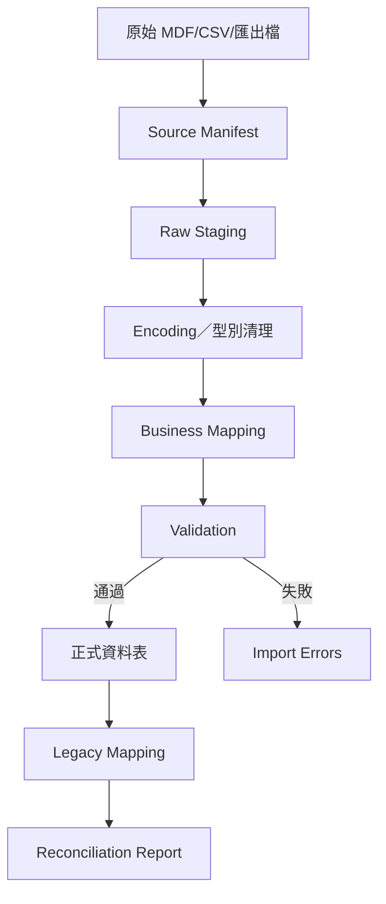

# 舊資料移轉計畫

> 目標：把舊系統可用資料安全帶到新系統，處理亂碼與缺漏，同時保留來源、核對結果及重跑能力。

本文件定義整體移轉原則；已提取真實舊表、初步筆數、逐表 mapping 與各功能同步的 Import Slice，請同時依照 `舊系統資料Import對照與分批計畫.md`。

## 1. 已知狀況

- 舊系統為 PowerBuilder 6，搭配舊 SQL Server 資料。
- 已提取多個 PBL 的視窗、DataWindow 與原始碼。
- 已成功匯出舊資料表結構及部分資料。
- I-0.2 已確認 `cust` 有 221 筆客戶資料；222 是包含表頭的 CSV 邏輯行數，225 個實體行則來自欄位內嵌換行。來源仍含 `U+FFFD` 與控制字元，必須先 staging 與抽樣確認。
- 舊資料包含客戶、供應商、工單／傳票、製程、完工存貨、出貨、計價、對帳與收款關聯。
- 部分舊功能已停用，但其歷史文字值可能仍需顯示。

原始資料位於專案外的 `../extraction/`，移轉工具只能讀取，不得修改來源檔。

## 2. 移轉原則

1. 原始檔唯讀封存並記錄 SHA-256、檔案大小與取得日期。
2. 先進 staging，不直接插入正式業務表。
3. 保存來源系統、來源表、來源主鍵及 import run。
4. 轉碼、清理、去重與業務 mapping 分開，不用一段不可理解的大腳本全部處理。
5. 每一類資料可重跑，同一來源不產生重複正式資料。
6. 無法轉換的資料進 error table，不靜默跳過。
7. 匯入後核對筆數、關聯、數量、金額及抽樣文件。
8. 試匯通過且公司簽認後，才在正式環境執行。
9. 正式切換前建立完整備份與回復點。

## 3. 移轉範圍分級

P0-10 已確認不限年份的全量匯入目標。以下「必須／建議／可只封存」不再是要不要處理的範圍，而是目的地與驗收強度：所有來源都必須被處理且能核對。

### 必須匯入

- 客戶主檔。
- 仍在進行或尚未完全出貨的工單。
- 尚有可出貨量的完工／存貨。
- 未完成計價的出貨。
- 未請款、未收款及部分收款資料。
- 與上述資料直接相關的供應商、紙質、製程及附件。

### 建議匯入

- 全年份的歷史工單、出貨、計價及對帳。
- 可用於價格記憶的歷史計價明細。
- 客戶常用工作項目。
- 歷史列印內容或可重建欄位。

### 可只封存查詢

- 品質不足、缺少關聯但依法或營運仍需保留的舊資料。
- 已停用模組且公司不要求在新版重新操作的歷史資料。

## 4. 匯入架構



### 建議表

- `import_runs`
- `import_source_files`
- `import_staging_records`
- `legacy_mappings`
- `import_errors`
- `reconciliation_results`

I-0.3 已先建立前五類 Import infrastructure；`reconciliation_results` 留給 domain dry-run／reconciliation 切片。Phase 0 使用通用 `import_staging_records`，每列分開保存 `raw_payload` 與 `normalized_payload`，並保留 run、來源檔、來源表、來源列號及 nullable source key。這是業務 schema 尚未簽認前的安全 envelope；I-1.x 起仍要由 customers、vendors、work orders 等 domain mapping 轉成 typed data，不可直接讓 JSONB 取代正式資料模型。

`import_errors` 依 run／file／row／field scope 保存，file、row 與 field error 必須能回到確切 source file 或 staging row。`legacy_mappings` 的來源 identity 唯一鍵跨 run 生效，同一 manifest 與檔案可重跑，但同一舊來源不可因換一個 run ID 再產生第二筆正式 mapping。

包含個資的 raw payload／raw value 不建立搜尋 index，不得進 log、測試 fixture、一般進度報告或 Git；I-1.1 前必須再完成管理者權限、保留期限、清除流程，以及禁止 `error_message` 拼接 raw value 的規則。

## 5. 編碼與亂碼處理

### 禁止作法

- 看到亂碼後直接在正式 CSV 用大量尋找／取代。
- 假設所有檔案都是 UTF-8。
- 轉碼失敗時以 `?` 或空字串靜默取代。
- 只看 Excel 顯示就認定檔案損壞。

### 安全流程

1. 保存原始 bytes。
2. 依舊系統語系、SQL Server metadata、已知中文字樣及工具結果產生候選 encoding。
3. 對姓名、地址、縣市、聯絡人及備註做抽樣。
4. 記錄選定 encoding 及轉碼工具版本。
5. 無法解碼的 byte 位置列入報告。
6. 輸出統一 UTF-8 staging。
7. 公司抽查高價值客戶及特殊字。

客戶 221 筆至少核對：

- 來源筆數。
- 客戶代號唯一數。
- 空名稱數。
- 統編格式分布。
- 電話／地址非空比例。
- 亂碼或 replacement character 數量。
- 指定客戶的代號、名稱、地址及聯絡人。

## 6. 欄位 mapping

### 客戶

| 舊欄位語意 | 新欄位方向 | 注意事項 |
|---|---|---|
| 客戶代號 | `customers.code` | 公司內唯一，保留前導零 |
| 名稱／簡稱 | `name`／`short_name` | 不自行合併 |
| 統一編號 | `tax_id` | 保留原值並另做格式警告 |
| 負責人／聯絡人 | customer／contact | 確認是否建立多聯絡人 |
| 電話、電話 2、行動、傳真 | contacts | 不把格式錯誤直接丟棄 |
| 縣市、郵遞區號、地址 | address fields | 保存原始完整地址 |
| `c_tax` 稅額請款 | billing settings | 確認值語意及百分比／旗標 |
| `bpoint` 每筆合計 | rounding policy | 確認舊值 0／1 語意 |

### 工單與製程

- 保留舊傳票號、客戶單號、品名、數量、交期。
- 材料拆為面紙、底紙、浪紙；無法區分時保留原始欄位及錯誤標記。
- 舊色別／裁紙內容保留為歷史文字，不建立新版維護主檔。
- 舊製程 mapping 到 `process_definitions`；未知製程使用明確的「舊資料未分類」代碼，不丟棄。
- 舊現行／歷史表匯入同一 `work_orders`，以狀態及 archived timestamp 區分。

### 完工與庫存

- 舊 `merchandise.finishnumber`、已出貨與備品數量不可只匯入一個目前餘額。
- 優先以可取得的完工、出貨來源重建 ledger。
- 若歷史事件不足，只能建立標示 `legacy_opening_balance` 的期初流水，並保存核對來源。
- 不把推估期初流水偽裝成真實完工事件。

### 出貨、計價與帳款

- 出貨明細保留來源工單／傳票。
- 計價保留來源出貨單及明細；舊 `sal`／`sal2` 對應主檔／明細。
- 請款與收款保留帳款期間、客戶、金額及來源。
- 已無法取得逐筆來源的彙總帳款，使用 `legacy_opening_receivable` 類型並清楚標示。

## 7. 匯入順序

```text
organizations/settings
→ users（只建立新帳號，不匯入舊密碼）
→ customers/contacts
→ vendors/master data
→ quotations（範圍確認後）
→ work_orders/materials/print specs/processes
→ completion/opening inventory
→ shipments/items
→ pricing/items/price history
→ statements/receipts/allocations
→ attachments/snapshots
```

每一步只在前一步核對通過後進行。

## 8. 核對方式

### 筆數

- 來源總筆數。
- staging 成功／失敗／警告數。
- 新增／更新／跳過數。
- legacy mapping 數。
- 無來源對應或孤兒數。

### 關聯

- 工單沒有客戶的數量。
- 製程沒有工單的數量。
- 出貨沒有工單的數量。
- 計價沒有出貨的數量。
- 請款沒有計價的數量。
- 收款沒有請款或客戶的數量。

### 數量

- 每工單完工總量。
- 正式出貨總量。
- 備品總量。
- 目前可出貨量。
- 負庫存或不合理異常清單。

### 金額

- 指定月份計價總額。
- 稅額。
- 請款總額。
- 已收與未收餘額。
- 客戶別及月份別差異。

### 抽樣

至少抽查：

- 10 筆一般客戶＋公司指定重要客戶。
- 10 張不同年份與狀態工單。
- 部分完工、多次出貨、含備品案例。
- 有額外版費／刀模費計價案例。
- 部分收款與未收款案例。

## 9. 重跑與回復

- 每個 import run 有唯一 ID、來源檔雜湊及程式版本。
- 相同來源重跑不得重複建立正式資料。
- 每筆新資料可由 `legacy_mappings` 找回來源。
- 試匯在獨立測試資料庫，可整庫重建。
- 正式匯入前備份；失敗時優先回復整個正式匯入 transaction／資料庫快照，不逐筆人工刪除。
- 若資料量使整批 transaction 不合理，使用可恢復批次與明確 checkpoint。

## 10. 切換策略

1. 完成至少一次完整試匯。
2. 公司簽認核對報告及例外清單。
3. 宣布舊系統資料凍結時間。
4. 建立舊系統最終唯讀備份。
5. 執行最終差異匯入。
6. 跑 migration、核對及 smoke test。
7. 公司抽查客戶、工單、庫存及未收款。
8. 批准新系統正式寫入。
9. 舊系統保留唯讀，不再雙向修改。
10. 觀察期內每日核對重要數量與金額。

## 11. 產出物

- Source manifest 與雜湊。
- 欄位 mapping 文件。
- 編碼判定與亂碼報告。
- 每次 import run 報告。
- 錯誤及人工處理清單。
- 筆數、數量、金額核對報告。
- 公司抽樣簽認。
- 最終匯入 commit／release 版本。
- 舊系統唯讀封存與回復說明。
