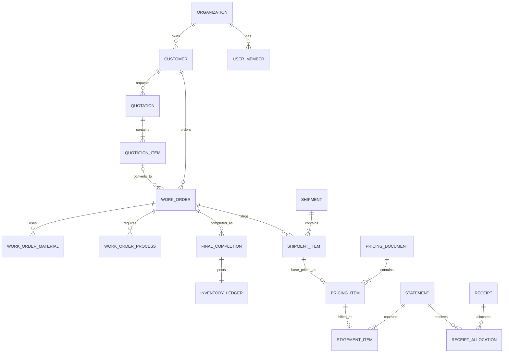

# 資料模型與業務規則

> 本文件把最容易出錯的資料關聯、數量、金額與狀態規則獨立列出。實作 service、migration 及測試時必須引用對應規則編號。

## 1. 核心關聯



所有業務表都屬於一個 `organization_id`。外鍵關聯除了 ID，也必須驗證來源與目標在同一家公司。

## 2. 文件與來源規則

### DOC-01 單號

- 同公司、同文件類型內唯一。
- 在資料庫交易內配置。
- 作廢後不得回收重用。
- 文件日期修改不自動更換已配發單號。
- 另存新檔一定取得新單號並保存 `source_document_id`。

### DOC-02 文件快照

報價確認、工單確認／列印、出貨確認、計價確認及對帳發行時，保存當時使用的：

- 公司抬頭。
- 客戶名稱、聯絡、地址及統編。
- 文件明細與價格。
- 稅別、稅率、取整方式。
- 模板版本。
- 操作者及時間。

歷史文件預設由快照重建，不重新讀取目前客戶主檔。

### DOC-03 直接建工單與轉工單

- `work_orders.source_quotation_item_id` 可為空，代表直接建立。
- 報價轉工單時保存來源明細，但工單建立後是獨立文件。
- 報價日後修改不得自動覆蓋既有工單。
- 是否允許同一報價明細重複轉工單由 P0-01 決定；若允許，需顯示既有轉換關係及原因。

### DOC-04 工單製版規格

- 製版製程保留協力廠與製程說明。
- `plate_version` 只能為 `new`、`existing` 或 `null`。
- `plate_rotation` 只能為 `top_bottom`、`left_right` 或 `null`。
- 版本與輪轉是兩個獨立維度，不得合併成四選一。
- 新建時兩者均無預設值；附件未授權後端依新舊版自動推導必填關係。
- 曬版、代版、留版、舊色別與裁紙值只存在於 legacy 歷史顯示，不進入新建編輯欄位。

## 3. 數量規則

### QTY-01 一般製程與最終完工分離

- `process_events` 只描述個別製程進度。
- `final_completion_entries` 才表示可入庫成品數量。
- 一般製程完成不得寫入 `inventory_ledger`。

### QTY-02 庫存流水

| 事件 | 流水方向 | 必要來源 |
|---|---:|---|
| 最終完工入庫 | 正 | `final_completion_entry_id` |
| 完工沖銷 | 負 | 原完工紀錄 |
| 正式出貨 | 負 | `shipment_item_id` |
| 備品扣除 | 負 | `shipment_item_id` |
| 出貨取消／沖銷 | 正 | 原出貨流水 |
| 人工增加 | 正 | 調整單、原因、核准者 |
| 人工減少 | 負 | 調整單、原因、核准者 |

不可直接 UPDATE 或 DELETE 原流水來改餘額。

### QTY-03 可出貨量

```text
可出貨量 = SUM(同公司、同工單、所有有效 inventory_ledger.quantity)
```

可在讀取模型建立 cache／summary，但 ledger 是最終真相；summary 必須能重建與對帳。

### QTY-04 出貨與備品

預設：

```text
實際扣庫量 = 正式出貨量 + 備品量
```

保存三個欄位，不只保存合計。後續計價預設以正式出貨量為基礎，備品是否計價由計價明細明確決定。

### QTY-05 出貨交易

建立出貨必須在同一交易中：

1. 鎖定來源。
2. 重新計算可出貨量。
3. 比較實際扣庫量。
4. 驗證權限／例外。
5. 寫出貨與負向流水。
6. 寫 audit。

### QTY-06 數量案例

| 步驟 | 事件 | 變動 | 可出貨量 |
|---:|---|---:|---:|
| 1 | 最終完工 600 | +600 | 600 |
| 2 | 第二次完工 400 | +400 | 1,000 |
| 3 | 正式出貨 500、備品 10 | -510 | 490 |
| 4 | 第二次正式出貨 300、備品 0 | -300 | 190 |
| 5 | 取消第二次出貨 | +300 | 490 |
| 6 | 人工盤減 5 | -5 | 485 |

任何實作只要無法得到上表結果即不得完成。

## 4. 計價規則

### PRICE-01 基礎計價唯一

- 每個有效 `shipment_item` 最多有一個有效「基礎計價」明細。
- 以資料庫部分唯一索引保護，不只在 UI 隱藏按鈕。
- 手動增加的版費、刀模費、運費等明細可沒有 `source_shipment_item_id`，但保留所屬計價文件與建立者。

### PRICE-02 價格歷史

價格建議至少顯示：

- 客戶。
- 品名／規格。
- 計價內容。
- 數量與單價。
- 使用日期。
- 來源計價單與出貨單。
- 是否為目前預設。

價格歷史不可因更新預設而刪除。

### PRICE-03 金額精度

- DB 使用 `NUMERIC`。
- API 使用十進位字串。
- 後端以 Decimal 計算。
- 前端可顯示格式化數字，但不得用 binary float 作最後金額。
- 單價顯示精度、計算精度與最後取整精度分開設定。

## 5. 請款與收款規則

### BILL-01 請款來源唯一

- 每個有效 `pricing_item` 最多出現在一個有效 `statement_item`。
- 取消請款後是否可重新請款，必須由狀態及有效唯一限制支援。

### BILL-02 金額快照

每張 statement 保存：

- `subtotal_before_rounding`。
- `rounding_adjustment`。
- `subtotal`。
- `tax_mode`。
- `tax_rate`。
- `tax_amount`。
- `grand_total`。
- `rounding_policy`。

正式欄位名稱可調整，但以上語意不可遺漏。

### BILL-03 收款分配

```text
有效分配合計 <= 收款有效金額
單張請款有效分配合計 <= 請款總額
未收餘額 = 請款總額 - 有效分配合計
```

- 一筆收款可分配多張請款。
- 一張請款可由多筆收款逐次清償。
- 沖銷收款會使相關請款餘額恢復。
- 不直接覆寫 statement 的「已收金額」作唯一真相，可保存可重建摘要。

## 6. 狀態與作廢

### STATE-01 Command 型狀態轉換

不得提供能任意把 `status` 改成任何字串的通用 API。使用明確 command：

- `confirm_work_order`
- `cancel_work_order`
- `record_final_completion`
- `reverse_final_completion`
- `confirm_shipment`
- `reverse_shipment`
- `confirm_pricing`
- `issue_statement`
- `record_receipt`
- `reverse_receipt`

### STATE-02 高風險操作

以下操作必填原因並稽核：

- 作廢文件。
- 沖銷完工、出貨、計價、請款、收款。
- 重開已完成製程。
- 人工庫存調整。
- 超量出貨例外。
- 變更已確認文件的可修改欄位。
- 更新預設價格。

### STATE-03 後續資料保護

- 已有出貨的完工不得直接取消；需處理後續關聯。
- 已有計價的出貨不得直接沖銷。
- 已有請款的計價不得直接取消。
- 已有收款的請款不得直接取消。
- UI 顯示阻擋原因；API 回傳穩定錯誤代碼。

## 7. 並行與版本

- 主要表有 `version`。
- 一般編輯使用 optimistic locking；版本不符回傳 conflict。
- 出貨、單號、計價、請款與收款等資源競爭操作使用資料庫鎖與唯一限制。
- 高風險 POST 支援 idempotency key 時，相同 key 與相同 payload 回同一結果；不同 payload 必須拒絕。

必測並行情境：

1. 兩人同時配發單號。
2. 兩人同時出貨同一庫存。
3. 兩人同時計價同一出貨明細。
4. 兩人同時請款同一計價明細。
5. 使用者重按完工或收款按鈕。

## 8. 刪除、封存與資料保留

- 草稿且沒有任何後續關聯的測試資料，是否允許 hard delete 仍以環境與權限限制；正式資料預設不 hard delete。
- 確認過的文件只能取消／作廢。
- 歷史工單用 `archived_at` 或狀態，不搬到另一張 history 表後刪除原資料。
- 停用主檔不得破壞歷史外鍵；停用項目不再出現在新建選單，但歷史可顯示。
- P0-10 要求全年份舊資料都被處理；每筆來源必須標記為正式匯入、只讀封存、合併／重複 mapping 或例外待處理。
- 無法安全轉換的亂碼或缺關聯資料不可靜默丟棄，也不可以空字串強塞正式欄位。

## 9. 租戶隔離

### TENANT-01 Context 來源

- 目前公司由經驗證 session 決定。
- 不信任 request body 的 `organization_id`。
- 建立資料時由後端注入公司 ID。

### TENANT-02 外鍵與唯一

- 單號、客戶代號等唯一條件包含公司 ID。
- 查詢、修改、下載附件及匯出都包含公司 scope。
- 必要時使用複合外鍵或 service 檢查避免跨公司關聯。

### TENANT-03 測試

每個主要模組至少一個 A／B 公司讀取拒絕和寫入拒絕測試。

## 10. 稽核內容

Audit 至少包含：

- organization、actor、action。
- entity type、entity id、document number，適用時。
- timestamp、request id、來源 IP 摘要，依隱私政策。
- before／after 的必要欄位。
- reason。
- success／failure 類型，依安全事件需要。

不得保存：

- 明文密碼或密碼雜湊。
- Session ID、Cookie、CSRF token。
- Cloud 金鑰與 Secret。
- 完整檔案內容。
- 與稽核無關的大量敏感個資。
