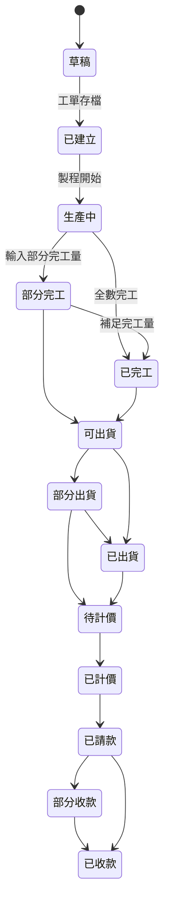

# 公司系統完整操作流程基準

## 1. 文件用途

本文件是後續 React 新系統分析、頁面設計、API 與資料庫設計的流程基準，整合三類證據：

1. 使用者整理的實際操作流程與 27 張操作圖片。
2. 舊 PowerBuilder 6 原始碼、視窗、DataWindow 與資料表關聯。
3. Gmail 資料夾中的公司新版需求、報價單與工單版面。

若三者出現差異，採用順序為：

1. 公司明確的新需求。
2. 實際操作流程及使用者說明。
3. 舊程式原始碼，用於補充欄位及歷史邏輯。

## 2. 完整業務主線

```mermaid
flowchart LR
    A[選擇客戶] --> B[建立工單／製程傳票]
    B --> C[填寫備紙與印刷]
    C --> D[填寫製程]
    D --> E[存檔與列印工單]
    E --> F[工單查詢]
    F --> G[製程監管]
    G -->|輸入實際完工數量| H[待出貨存貨]
    H --> I[建立出貨單]
    I --> J[列印出貨單]
    J --> K[出貨計價]
    K --> L[計價查詢／明細]
    L --> M[請款對帳單]
    M --> N[收款與未收款追蹤]
```

## 3. 工單／製程傳票建立

### 步驟 1：選擇客戶

- 開啟製程傳票／工單建檔。
- 從客戶下拉或搜尋視窗選擇客戶。
- 舊系統以客戶代號選取。
- 帶入客戶名稱、電話、聯絡人等資料。

新系統要求：

- 可用客戶代號、名稱或簡稱搜尋。
- 選取後自動帶入客戶資料。
- 不應要求使用者重複輸入既有客戶資訊。

### 步驟 2：填寫工單基本資料、備紙與印刷

基本資料：

- 工單／傳票號碼
- 工單日期
- 客戶單號
- 工作／品名
- 訂購數量
- 交貨日期
- 單價
- 備註

備紙與印刷：

- 面紙、底紙及浪紙
- 紙質、供應商、廠別、尺寸、數量
- 印刷尺寸
- K 數、模數
- 印刷數量及加減量
- 正面／反面 CMYK
- 特別色
- 上光
- 裱紙／裱浪

使用者整理的流程註明「版」的部分功能可能不再需要。Gmail 新版工單仍保留新版／舊版及輪轉選項，因此實際刪除範圍需再確認，不能直接把全部製版欄位移除。

### 步驟 3：填寫製程

製程內容包括：

- 美工
- 輸出
- 曬版／製版
- 打樣
- 印刷
- 上光
- 裱紙
- 模具
- 軋型
- 裁切
- 糊邊
- 運送
- 其他加工

實際作業規則：

- 舊版工作通常不需要重新填寫曬版。
- 新版工作才需要填寫曬版／製版資訊。
- 上光、軋型等後加工仍需填寫。
- 可記錄數量、單價、協力廠及備註。

新系統建議：

- 先選新版／舊版，再動態顯示必要製程。
- 舊版時將曬版標為不適用，而非保留空白造成誤判。
- 每個製程有「是否需要」「協力廠」「內容」「數量」「單價」「狀態」。

### 步驟 4：存檔及列印工單

- 工單資料存檔後即可列印。
- 舊系統使用工作傳票列印視窗。
- 新需求要求建檔內容合併為單一頁面，並使用新的工單列印版面。
- 工單可包含刀模圖或產品示意圖片。

## 4. 工單查詢

### 步驟 5：查詢剛建立的工單

- 存檔後可在「傳票查詢」找到工單。
- 可開啟並檢查完整內容。

### 步驟 6：現行與歷史查詢

舊系統分為：

- 傳票查詢
- 歷史傳票查詢

公司希望：

- 增加訂單搜尋與過濾。
- 搜尋內容更詳細。
- 加入關鍵字查詢。
- 兩個查詢可以考慮合併，但仍需公司最後確認。

React 建議：

- 使用單一「工單查詢」頁。
- 狀態篩選：草稿、進行中、已完工、已出貨、歷史／封存。
- 不再以兩個不同資料表與不同頁面區隔現行及歷史資料。

## 5. 製程監管與完工數量

### 步驟 7：在製程監管找到工單

- 工單存檔後會出現在製程監管清單。
- 清單中的工單號碼對應先前建立的工單。
- 點選工單後，下方顯示各製程項目。

### 步驟 8：更新製程與實際完工數量

- 點選對應製程，例如運送。
- 輸入實際完成／可出貨數量。
- 執行更新。

關鍵規則：

- 必須先在製程監管寫入完工數量，該品項才會出現在存貨及出貨選單。
- 原始碼會把完工數量累加到 `merchandise.finishnumber` 待出貨庫存。
- 完工資料會轉入歷史傳票與歷史製程資料。

React 建議狀態：

- 未開始
- 進行中
- 部分完工
- 已完工
- 可出貨

每次完工數量調整需留下操作者、時間、調整前後數量及原因。

### 步驟 9：存貨查詢

- 更新完工數量後，可在存貨查詢看到該品項。
- 存貨代表已完工且尚可供出貨的數量。
- 可用數量應為：累計完工量－累計出貨量－備品量調整。

## 6. 出貨作業

### 步驟 10：建立出貨單

- 開啟出貨作業。
- 建立新的出貨單。
- 選擇客戶名稱。

### 步驟 11：選擇待出貨品項

- 選擇客戶後，系統列出該客戶可出貨的訂貨品項。
- 新增出貨明細列。
- 點擊明細列，開啟待出貨物品選擇視窗。
- 可一次選取一筆或多筆訂單項目。

### 步驟 12：輸入數量與列印出貨單

- 輸入出貨數量。
- 如有需要，輸入備品量及備註。
- 存檔後累計已出貨數量。
- 可立即列印出貨單。

出貨明細必須保留：

- 來源工單／傳票號碼
- 客戶訂單號碼
- 品名
- 完工量
- 本次出貨量
- 累計出貨量
- 尚可出貨量
- 備品量

## 7. 出貨計價

### 步驟 13：進入計價作業

- 出貨完成後，進入計價頁面。
- 計價頁的出貨單瀏覽區顯示已出貨資料。
- 尚未計價的資料以黃色顯示。
- 完成計價後改為白色。

新系統不能只依賴顏色，還需顯示文字狀態：

- 待計價
- 計價中
- 已計價
- 已取消

### 步驟 14：選取出貨單並完成計價

- 在出貨單瀏覽找到要計價的出貨單。
- 點選該出貨單。
- 切換至計價項目區。
- 按下計價並存檔。
- 系統將出貨資料轉為計價主檔及明細，並標記避免重複計價。

## 8. 計價查詢與計價明細

### 步驟 15：查詢已計價資料

- 開啟計價查詢。
- 選取剛完成計價的資料。
- 開啟明細修改。

### 步驟 16：新增計價項目

- 舊系統使用滑鼠右鍵「增加一行」。
- 每列包含內容、數量、價格及小計。
- 內容與價格目前需要人工逐筆輸入。

公司明確希望新增「記憶功能」：

- 不要每次重打相同內容及價格。
- 依客戶、品名或計價項目記住歷史內容與最近價格。
- 輸入時提供自動完成及歷史價格選擇。
- 顯示價格日期，避免誤用太舊的單價。
- 建議保留「只套用本次」及「更新預設價格」兩種操作。

## 9. 請款與後續帳款

### 步驟 17：列印請款／對帳單

- 計價內容及價格完成後，可進入請款對帳作業。
- 選擇客戶及帳款日期區間。
- 讀取已計價項目。
- 列印請款／對帳單。

後續舊系統關聯：

- 營收統計
- 應收帳款彙總
- 收款作業
- 收款明細查詢
- 未收款查詢

## 10. 流程狀態模型

## 11. Gmail 新需求覆蓋到本流程的位置

| 新需求 | 影響流程 |
|---|---|
| 報價單新建檔與 A4 列印 | 工單建立前的報價階段 |
| 工單合併單頁 | 步驟 1～4 |
| 自動單號與日期 | 報價及工單建立 |
| 客戶資料自動帶入 | 步驟 1 |
| 面紙、底紙、浪紙 | 步驟 2 |
| CMYK、特別色及圖片 | 步驟 2～4 |
| 關鍵字與詳細篩選 | 步驟 5～6 |
| 查詢結果增加單價、版費、刀模費 | 工單查詢 |
| 色別設定、裁紙設定不用做 | 基礎設定與工單欄位來源 |
| 雲端＋硬碟備份 | 全系統及所有附件 |
| 計價內容與價格記憶 | 步驟 15～16 |

## 12. 後續設計不可遺漏的規則

1. 沒有完工數量，不得建立超過可用量的出貨明細。
2. 允許部分完工、部分出貨及多次出貨。
3. 每張出貨單及計價項目都能追溯來源工單。
4. 同一出貨明細不得重複計價。
5. 黃色／白色狀態需改為顏色加文字，避免只靠顏色判讀。
6. 計價記憶需顯示來源客戶、品項、價格及日期。
7. 現行／歷史工單應以狀態區分，不應搬移後刪除原資料。
8. 工單及報價的另存新檔需產生新單號並保留來源關係。
9. 圖片附件、資料庫及列印檔都必須納入備份。
10. 所有關鍵操作需保留操作記錄。

## 13. 仍待公司確認

- 傳票查詢與歷史查詢是否正式合併。
- 「版的功能不用」實際指整個版區，還是只刪除部分代版／留版欄位。
- 新版／舊版對曬版欄位的必填規則。
- 製程監管中的「運送」是否等同最終完工核定。
- 是否允許超量出貨或負庫存，以及誰有權限。
- 計價記憶依客戶、品名、規格或全公司共用。
- 歷史價格預設取最近一次、最低價、最高價或指定價目表。
- 請款單是否等同對帳單，或需要兩種不同列印格式。
