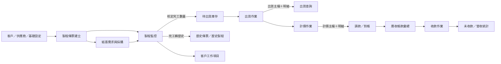
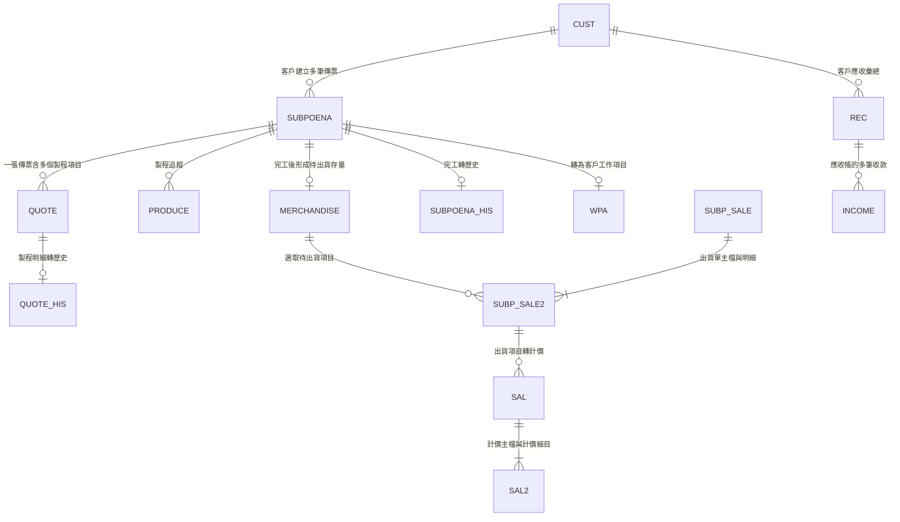
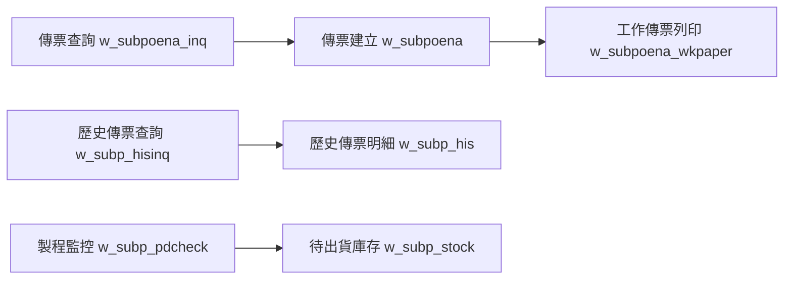
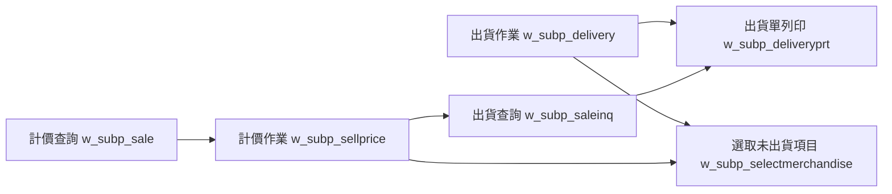
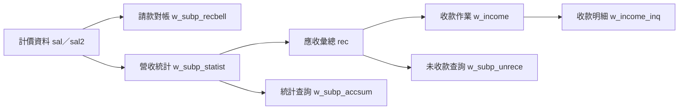

# 舊版印刷管理系統：功能關聯分析

> 本文件記錄程式與資料關聯；完整人工作業順序以同資料夾的「公司系統完整操作流程基準.md」為準。

## 1. 分析結論

可以從 PowerBuilder 原始碼得到四層關聯：

1. 主選單與功能模組的包含關係
2. 功能選單與實際視窗、子視窗、列印視窗的開啟關係
3. 視窗與 DataWindow／報表的使用關係
4. DataWindow／程式事件與資料庫資料表的讀寫、轉檔關係

目前已自動建立 379 條可追溯關聯，詳細資料位於 `feature_relationships.csv`。

## 2. 核心業務流程關聯

## 3. 主要資料流與程式證據

| 階段 | 來源 | 寫入／影響 | 關聯證據 |
|---|---|---|---|
| 建立傳票 | 客戶、供應商、紙質、色別等基礎資料 | `subpoena` 傳票主檔、`quote` 製程明細 | `w_subpoena.srw`、`d_subp.srd`、`d_subp_contect1_a.srd` |
| 產生紙張需求 | 製程傳票 | `subp_paperpru` 紙張採購需求 | `w_subpoena.srw` 直接執行 `INSERT INTO subp_paperpru` |
| 製程追蹤 | 製程傳票 | `produce` 製程進度 | `w_subp_pdcheck.srw`、`d_subp_pdchecklist.srd` |
| 完工入待出貨庫存 | 製程核定的完工數量 | `merchandise.finishnumber` | `of_tr2merchandise()` 明確註解為傳送完工數量到待出貨檔 |
| 完工轉歷史 | `subpoena`、`quote` | `subpoena_his`、`quote_his` | `of_complete()`、`of_tr2quote_his()` |
| 更新常用工作項目 | 完工傳票 | 新增或更新 `wpa` | `of_complete()` 將訂單資料轉給客戶工作項目檔 |
| 建立出貨單 | `merchandise` 待出貨資料 | `subp_sale` 出貨主檔、`subp_sale2` 出貨明細 | `w_subp_delivery.srw` 使用 `d_subp_deliver1/2` |
| 調整庫存 | 出貨量、備品量 | 累加 `merchandise.delivernumber`／備品數量 | `w_subp_delivery.srw` 存檔事件 |
| 出貨計價 | `subp_sale`、`subp_sale2` | `sal` 計價主檔、`sal2` 計價明細 | `w_subp_sellprice.srw` 的函式註解明確寫「將計價資料傳輸到 sal1、sal2」 |
| 防止重複計價 | 已計價的出貨明細 | 出貨明細 `tr_ok=1` | `w_subp_sellprice.srw` 計價完成事件 |
| 請款／對帳 | `sal`、`sal2` | 對帳單與應收統計 | `d_subp_recbell1.srd` 同時讀取 `sal`、`sal2` |
| 營收轉應收 | 計價及營收統計 | `rec` 應收彙總、`lsm` 營收彙總 | `w_subp_statist.srw` 的 `wf_lsm2rec()` |
| 收款 | 收款記錄 | `income`，並更新 `rec` 的收款與結餘 | `w_income.srw` 的應收帳資料處理函式 |

## 4. 關鍵資料表關聯

### 已確認的關聯鍵

- `subpoena.id`：傳票識別碼；被 `quote.subpoenaid`、`produce.subpoenaid`、`merchandise.subpoenaid` 等資料引用。
- `subp_sale.deliverid`：出貨單號；連接出貨主檔與 `subp_sale2` 明細。
- `sal.sal_da + sal.sno`：計價日期與序號；連接 `sal2.sal_da + sal2.sno`。
- `sal.deliverid`：保留來源出貨單號，可由計價追溯回出貨。
- `cust.c_no`：客戶代號；被計價、應收、對帳及收款功能共同使用。

## 5. 功能視窗的呼叫關係

### 製程傳票

### 出貨與計價

### 帳款

## 6. 共用主檔對其他模組的影響

| 共用資料 | 被哪些功能使用 |
|---|---|
| 客戶 `cust` | 傳票、報價、出貨、計價、對帳、收款、未收款、報表 |
| 供應商 `fact` | 紙張供應、外包製程、上光、裱浪、加工單價 |
| 客戶工作項目 `wpa` | 傳票快速帶入、完工後更新常用產品／印刷規格 |
| 紙廠／紙質／紙張 | 備紙、採購、進貨、庫存、工作傳票 |
| 色別、上光、裱浪、裁紙 | 傳票的印刷與後加工內容 |
| 公司資料 | 報價單、工作傳票、出貨單、對帳單等列印抬頭 |
| 使用者與權限 | 控制各功能是否可新增、修改、刪除、查詢或列印 |

## 7. 現用與停用關係

原始碼存在不代表目前使用。主選單原始碼顯示：

- 「物料管理」整個模組：隱藏且停用。
- 加減量資料設定：隱藏且停用。
- 印刷價格設定：隱藏且停用。
- 版別／輪轉設定：隱藏且停用。
- 紙張應付對帳及應付統計：隱藏且停用。
- 部分系統轉檔及資料整理：停用或隱藏。

`feature_relationships.csv` 的 `status` 欄會保留這個差異，避免 React 翻新時把廢棄功能誤當成必做功能。

## 8. React 翻新時應保留的核心關聯

新系統不應只複製舊畫面，應將上述資料關聯改為可追蹤的單一流程：

- 從客戶頁可查看該客戶的報價、訂單、出貨、應收及收款。
- 從訂單頁可查看備紙、採購、製程進度、完工量、出貨量、計價與收款狀態。
- 每筆出貨明細必須保留來源訂單及製程傳票。
- 每筆計價明細必須保留來源出貨單。
- 每筆應收與收款必須可追溯到計價及出貨資料。
- 完工轉歷史不應真的搬移／刪除主資料，建議改用狀態與封存日期，保留完整稽核紀錄。
- 所有狀態改變應記錄操作者、時間、原值與新值。

## 9. 關聯信心等級

- **高信心**：原始碼有明確 `Open/OpenSheet`、DataObject、SQL `INSERT/UPDATE/DELETE` 或函式註解。
- **中信心**：DataWindow 同時讀取多張資料表，可確認查詢關聯，但未必代表資料會被更新。
- **待確認**：報價單是否自動轉製程傳票、人工核准規則、紙本簽核、Gmail 補充流程及例外處理。
